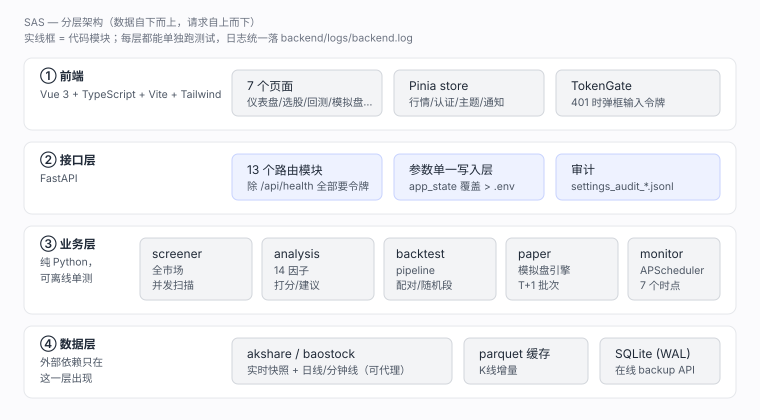
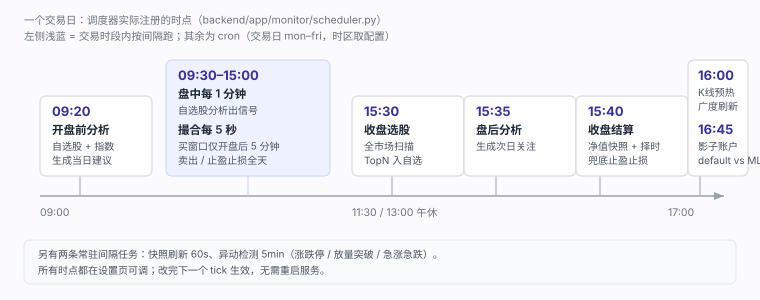
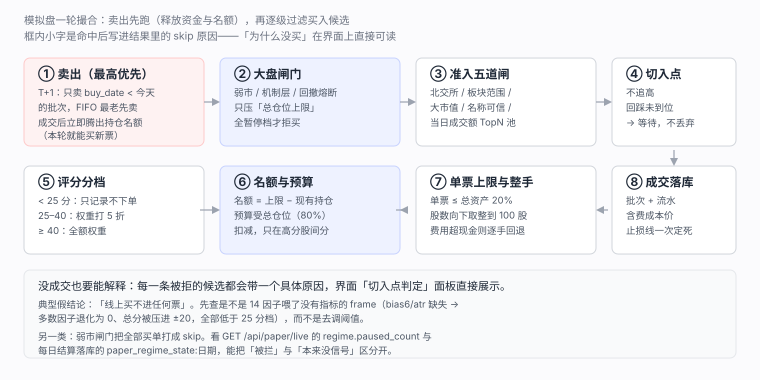

# SAS — A股智能分析系统

面向国内 A 股（沪深京）的个人学习研究工具：实时行情监控、技术指标策略全市场选股、历史回测，并可选接入大模型生成结构化买卖建议。

> **免责声明：本系统仅供学习研究使用，所有数据与结论不构成任何投资建议。股市有风险，投资需谨慎。**

## 速览

三张示意图把「代码长什么样 / 一天怎么跑 / 下单为什么没成交」讲完（可点开放大）：

| 分层架构 | 交易日时间轴 | 下单链路与买入闸门 |
| --- | --- | --- |
| [](docs/images/architecture.svg) | [](docs/images/daily-timeline.svg) | [](docs/images/paper-gates.svg) |

> 上述为**示意图**（按 `backend/app` 实际模块与 `scheduler.py` 实际时点绘制），不是界面截图。
> 界面截图欢迎提 PR 放进 `docs/images/`——请避免露出真实账户金额与密钥。

## 文档地图

| 想了解 | 看这里 |
| --- | --- |
| 能做什么、怎么装、怎么部署 | 本文件 |
| **一次买卖从哪来、经过哪些判定、被哪些参数挡住** | [`docs/flow.md`](docs/flow.md)（全链路流程图 + 参数总表 + skip 原因速查） |
| 公式与代码落点（选股→策略→因子→下单风控→撮合→参数表→回测对齐） | [`docs/sas_formulas.md`](docs/sas_formulas.md) |
| 哪些想法试过、结论如何、为什么**不采纳** | [`BACKTEST_LOG.md`](BACKTEST_LOG.md) |
| 策略变更逐条记录（含「为什么」） | [`WORKLOG.md`](WORKLOG.md) 第十一节 |
| 怎么贡献、口径红线、验收纪律 | [`CONTRIBUTING.md`](CONTRIBUTING.md) |

## 快速开始（Windows，约 5 分钟）

```powershell
git clone https://github.com/LumberWG/SAS.git
cd SAS

# 1) 后端
cd backend
python -m venv .venv
.venv\Scripts\pip install -r requirements.txt     # 要严格复现历史结论，改装 requirements.lock.txt
copy .env.example .env                             # 按需改 API_TOKEN / 数据目录 / LLM
.venv\Scripts\python -m uvicorn app.main:app --host 127.0.0.1 --port 8000

# 2) 前端（另开一个终端，回到仓库根目录）
cd ..\frontend
npm ci
npm run dev                                        # → http://localhost:5173
```

- **首次启动会构建 K 线缓存**（全市场日线，耗时数分钟），期间选股 / 回测结果偏少是正常的，别急着判定「策略无效」。
- **分钟线（分时图 / 分钟回测）另有一份本地库**：`data\minute1_fsdb` 与 `minute5_fsdb`，由本地行情库 fsdb 导出，
  不走 akshare。缺了它只影响分时图与分钟级回测，不影响日线选股：
  ```powershell
  cd backend
  .venv\Scripts\python.exe scripts\run_minutes_all.py                      # 补到最近交易日（只补增量）
  .venv\Scripts\python.exe scripts\run_minutes_all.py --end 20261030       # 只补某一天
  ```
  生产环境由计划任务 `SASMinutesFsdb`（每交易日 **17:30**）自动跑一次。
- 只想一条命令起前后端：`python scripts\dev\start_dev.py`（含端口清理与健康检查，前端 HMR + 后端 `--reload`）。
- `API_TOKEN` 留空时接口不校验令牌；**一旦设置**，除 `/api/health` 外所有 `/api/*` 都要带 `X-API-Token`，
  前端会弹框让你输入（浏览器本地保存）。curl 调试记得加 `-H "X-API-Token: ..."`。
- 还要配 LLM / 通知 / 数据源代理？见下文「完整安装与配置」；生产部署（nssm 服务 + 计划任务）
  见「代码更新流程」。

## 功能总览

| 模块 | 能力 |
| --- | --- |
| 实时行情 | 三大指数概览、涨跌家数、成交额统计、市场情绪分级（5 档权重）、自选股盯盘 |
| 自选股 | 个股详情页/扫描结果一键加自选（⭐按钮），Signals 页管理列表，实时价盯盘 |
| 智能建议 | 收盘自动选股评分 TopN 自动加自选；盘中 5 分钟分析自选股生成买入/卖出建议；盘后生成明日关注 |
| 策略选股 | 6 种内置经典策略 + 自定义策略，全市场 5000+ 股票并发扫描，命中信号自动持久化 |
| 策略编辑 | 所有策略参数前端可调，支持另存为自定义策略（持久化，重启自动加载） |
| LLM 智能分析 | 接入任意 OpenAI 兼容大模型，生成决策仪表盘（结论 + 入场价/止损价/目标价 + 六维检查清单） |
| 历史回测 | 信号驱动回放，输出收益率/胜率/最大回撤/夏普与净值曲线 |
| 定时监控 | 盘中快照刷新、异动检测（涨跌停/放量突破/急涨急跌）、收盘后自动选股推送 |
| 风控机制层 | 四态动态降暴露（calm/weak/shock/crisis）+ 政策托底分治 + 硬性回撤熔断，**默认全关**；只压总仓位上限、不放大，关闭时与改造前逐行一致 |
| 运维保障 | 应用日志落盘（10MB×5）、访问令牌、每日 SQLite 在线热备份（保留 30 份）、涨跌家数广度观测 |
| 运维审计页 | `/ops` 只读展示进程内调度任务与下次执行时间、行情数据新鲜度、访客访问记录（近 1/7/30 天、排除开发者、按 IP 去重）；Windows 计划任务只列口径与时刻，不伪造运行状态 |
| 移动端与导出 | 窄屏（<1024px）侧栏收起为汉堡菜单 + 遮罩、切页自动收起；个股日K 支持 60/120/250 日区间与上证基准相对强弱副图（两条线归一到窗口首日 0%）；扫描命中、模拟盘流水、回测逐笔与净值曲线、访客记录均可导出 CSV（统一 BOM + 引号转义） |

## 系统设置

`/settings` 页把散在四处的配置拉成一张表：`.env`/`config.py`（107 项）、`app_state` 运行时覆盖、页面上各业务开关、以及少量硬编码常量（可交易板块前缀、巨无霸黑名单、回测默认止损止盈、整手股数）。

> ⚠️ **配置生效铁律（改任何参数前先读这一条）**：本系统**不是「改 `.env` + 重启」就万事大吉**。
> 运行时存在一层 **`app_state` 持久覆盖层**（存于数据库）：凡经「设置页 / `POST /api/settings`」调过的参数会写入
> `app_state`，并在**每次启动时重放、优先级高于 `.env`**（来源胶囊显示 `运行时`）。结果：某个键一旦被页面调过，
> 你之后只在 `.env` 里改它，就会被旧覆盖值压住、**重启也清不掉**（真实踩坑见 `BACKTEST_LOG.md` #114）。
> - **正确改法**：走设置页 / `POST /api/settings`（立即生效 + 落库 + 重启保留），或对单键「还原」重读 `.env`；**不要只改 `.env` 然后指望重启**。
> - **改完必做**：`GET /api/settings` 回读该键的 `value` 与 `source`，确认已变为预期（别只信 `.env` 写了什么）。
> - **只读项**（`db_path` / `kline_dir` / `cors_origins` / `app_name` / `debug` 等）只能改 `.env` 后重启，页面/接口不接收其改动。

页面上**只列可编辑的 97 项**。以下 10 项都**完全不显示**（`READONLY_KEYS`）：`api_token`（访问令牌，回显等于把钥匙挂在门上）、`db_path`、`kline_dir`、`cors_origins`、`data_no_proxy_domains`、`auto_scan_strategies` 与 `app_name`（只在启动时用于 `FastAPI(title=)`，改它连前端标题都不变）、`debug`（全仓库无人读取的历史字段）、`disclaimer`（接口 JSON 统一注入的文案常量，不是配置）、`notify_email`（`EmailNotifier` 目前只打日志并返回 False，开了反而多记一条渠道失败），以及剩余硬编码常量（`LOT_SIZE`、板块前缀、巨无霸名单、回测默认止盈止损）。理由一致：改不了或改了没效果，展示了只会让人以为能调。

> 评分阈值（`factor_buy_threshold` / `factor_sell_threshold`）与四项费率（`trade_fee_*`）**已从硬编码挪进配置**：前者决定 buy/sell 判级，后者被回测与实盘共用。整手股数（`LOT_SIZE=100`）仍固定——改了会下出非法委托。

- **外观主题（顶栏右侧下拉）**：位于「未保存」指标右边、分隔线之前；石墨黑 / 深海蓝 / 象牙白 / 暖沙，**默认象牙白（浅色）**，选完即时生效。按钮与每个菜单项左侧都保留四格预览色（页面底 / 卡片 / 主色 / 文字），收起时也能看出当前配色。
  这是**纯前端偏好**（存 `localStorage`），不进 `app_state`、不影响后端与其它电脑 —— 显示习惯不该混进业务参数表
- **条件可见**：子参数依赖父开关时默认隐藏（例：`paper_t_active` 关着时，8 个做T 参数不显示；
  `llm_enabled` 关着时，接口地址/密钥/模型/超时都不显示）。关系在 `param_specs._DEPENDS_ON` 里声明，
  父项为开关则「开=显示」、为文本则「非空=显示」，支持套娃；前端按**草稿值**实时显隐
  （打开做T 开关的那一下，下面参数立刻出现，不用等保存），分组标题会标「随开关隐藏 N」
- **两级布局（均衡分组）**：左侧竖排导航 8 个分组——连接与扫描 20 / 选股与自选 30 / 账户与费率 14 / 交易执行 42 / 仓位与轮动 16 / 风控与止损 22 / 做T 与择时 34 / 调度与 LLM 16（合计 97），每项标该组总数与已覆盖数。之所以不做平铺 tab：按 `paper_` 前缀天然会变成「一组 50 项、另一组 1 项」。布局由 `param_specs._LAYOUT` 按业务语义声明（分组 → 组内小节 → 键），新增字段没收录时按前缀兜底进对应组的「其他」小节
- **组内小节**：每个分组再切成 2~5 个语义小节（如「风控与止损」= 买点切入 / 固定止损止盈 / ATR 与移动保护），小节标题右侧带一句说明；搜索时跨全部分组按小节分段展示命中结果
- **可编辑**：开关项点一下、数字项直接输，改完点顶栏的「保存 (N)」（改动后页面底部也会浮出「有 N 项未保存 · 保存并生效 / 放弃」条，往下翻几屏也能保存）；每行是「固定列宽（104px）右对齐的短标签 + 紧挨着的控件 + 靠右的来源胶囊」，标签与输入框之间不再撑出一大段空白；完整 key / 说明 / 当前值都在行 tooltip 里，**来源**（`运行时` = app_state 覆盖 > `.env` > `默认`）以胶囊标记，改动行高亮，可单行撤销、整组「本组还原」或全局「还原」为 `.env` 值
- **短标签 + tooltip**：卡片里只放标准短名（`固定止损`、`买单队列上限`、`ATR 止损倍数`，见 `param_specs._SHORT_LABELS`，最长 10 字），`config.py` 里那整句注释作为 `desc` 放进行悬停提示，连同完整 key、当前值、待保存值一起显示；有跨页补充说明的行在标签右侧带一个黄色提示点
- **写模型**：改 `app_state` 覆盖层 + 就地改 `Settings` 单例，**下一个 tick / 下一轮扫描即生效**，重启由启动流程重放，不会丢
- **只读项**：路径与列表类（`kline_dir`、`db_path`、`cors_origins` 等）在进程启动时就被静态挂载 / CORS / 缓存目录捕获，`POST /api/settings` 直接拒绝（400），`GET /api/settings` 也不返回；要改请改 `.env` 后重启。`app_name`、`debug` 同理不进清单
- **还原（二次确认）**：顶栏「还原」= 还原**全部**可编辑项，组头「本组还原」= 只还原本组；
  两者都弹确认框，写明「N 项 + 目标值来自本机 `.env`（无 `.env` 时等于代码默认）+ 不可撤销」。
  早先「有未保存改动就只还原那几项、否则还原全部」的隐式分支已去掉 —— 同一个按钮两种行为容易误点
- **敏感项脱敏**：`llm_api_key`、`notify_webhook_url` 在接口里只返回掩码（`sk-****abcd`），行尾带「密钥」标记；
  前端把掩码原样回传时后端视为「未修改」，输入新值才覆盖，传空串才是清空
- **审计**：每次保存/还原追加一行 JSON 到 `data/logs/settings_audit_YYYYMMDD.jsonl`
  （`ts / action / keys / values（密钥只留掩码）/ ip / ua`）—— 多环境部署后「谁还原了什么」只能靠它复盘
- 支持按标签 / key / 值 / 说明搜索（有筛选条件时跨全部分组，左栏同步显示每组命中数），筛「只看已覆盖」；接口 `GET /api/settings`、`POST /api/settings`、`POST /api/settings/reset`

## 回测参数可调与做T引擎（心得策略）

回测中心（`/backtest`）已支持把 `PipelineParams` 的全套风控参数在 UI 上逐项调整（共 8 组，见下一段的分组说明）。

参数框里显示的是**具体默认值**（后端 `GET /api/backtest/defaults` 统一算出线上配置，前端不再显示「默认」占位），并且按改动方向着色：**比默认大 = 红、比默认小 = 绿、等于默认 = 常态色**；鼠标悬停可看默认值。「关闭/不限」类参数默认就是 `0`，提交时值为 `0` 即略过该字段（等价于 `None`）。顶部有「重置」一键回到默认。

参数面板按 8 个分组（基础 / 选股买入 / 五段式（队列与切入点）/ 止损止盈 / 移动保本 / 大盘择时 / 仓位评分轮动 / 做T引擎）折叠展示，每个参数一张卡片（标签一行、输入框占满一行），不再把标签和 60px 输入框挤在同一行。

**打分层（2026-10-31 新增，`BACKTEST_LOG` #79）**：「选股/买入」组顶部有 `打分层` 下拉——`14因子` / `ML分位` / `ML+因子融合`，**默认跟随实盘开关**（`live_ml_scoring` 开则为 ML），避免「回测跑 ML、实盘还在 14 因子」的口径漂移。同组可调 `ML模型`（LightGBM，缺依赖自动回退 Ridge）、`ML标签前瞻`、`融合权重`、`ML行业中性化`。**结果里的 `ml_diagnostics` 必须看**：`effective=false` 表示 OOS rank-IC ≤ 0 已**整段回退 14 因子**，这次跑的其实不是 ML（与基线数字完全相同）。短区间（十几个交易日）只有十几个截面、IC 估不出来，几乎必然回退——要看 ML 请跑 **≥ 半年**，或直接用 `scripts/random_dist.py` 那套 18 段 × 21 天（`#76`）。落盘时只有 `打分层` 能同步到实盘 `live_ml_scoring`，模型/前瞻/融合比例/中性化都是回测专属。**股票池默认 300**（跟随线上 `paper_pool_top_n`；2026-10-31 由写死的 500 改回），与 `#76` 验收口径一致——填 500 跑出来的是「Top500 里的 ML」，与线上和 `#76` 都不是同一实验。

**入场时点与口径对照（2026-11-07）**：「五段式」组新增 `入场时点(分钟)`（`entry_open_delay_minutes`）——`0` = 次日开盘价（历史口径），`>0` = 开盘后 N 分钟那根 5m bar 的收盘价；`GET /api/backtest/defaults` 默认取实盘 `paper_open_cooldown_minutes`（本机 5），落盘映射也指回该字段。#108 之前这个口径只写在 `profiles.cur10` 里，页面既看不到也改不了，默认回测按开盘价跑、实盘却在 09:35 之后才买，两边数字无法互证。结果区另有常驻「口径对照」：本次入场价 / 实盘冷静期 / 本次池 `TopN` 与线上池，并附可展开的已知偏差清单（实盘窗口=0 全时段可买、开盘价成交乐观 1.4~2.5pp、回测无候补队列与盘内错峰与收盘减仓、分钟数据从 2025-01-02 起、盘中新信号不可回测）与 `#70 §6` 判读门槛（−1pp ~ +5pp、不足 21 交易日不下结论）。

**两套参数必须分清**（面板顶部有常驻说明）：
- 改参数 + 「开始回测」——只影响**本次回测**，不碰实盘；
- 「将规则落盘保存到数据库」——把这套规则写进配置库（`app_state` 覆盖层），立即对**选股 + 模拟盘交易**生效，重启保留，并成为新的默认值。只同步实盘有落点的子集（止损/止盈/单票上限/仓位/买入阈值/评分档/择时/买入切入点/入场时点/做T 等，共 32 项），其余（板块组合、调仓周期、分位门槛、反转选股、分段止盈、时间止损、分钟级切入点）逐条列出「未同步」原因。落盘前有确认框展示「会变更哪几项：旧值 → 新值」。接口 `GET /api/backtest/persist-map`、`POST /api/backtest/persist`；映射表见 `app/backtest/apply.py`。

**回测结果自动落库（2026-11-01）**：每次回测跑完即写库，不需要任何操作，便于事后分析：
- `backtest_runs`：`params`（本次全量参数）、`metrics`（收益/基准/回撤/夏普/胜率…）、`equity_curve`（**过程数据**：逐日 `equity / benchmark / cash / positions`）、`positions`（期末持仓）、`review`（亏损归因 + 调参建议）、`job_id`（与 `backend.log` 对齐，日志里的任务 id 能直接定位到这条记录）、`elapsed`
- `backtest_trades`：逐笔成交单独成表（代码/名称/买入日/卖出日/买入价/卖出价/股数/金额/费用/盈亏/收益率/卖出原因/建仓评分），可以直接 SQL 聚合「按卖出原因」「按股票」「按评分档」
- `GET /api/backtest/{run_id}` 返回含 `trades` 的完整结果；`GET /api/backtest` 只返回摘要（不带曲线与明细，附带 `trade_count`），避免 50 条 × 上万字符把列表接口撑爆
- 该功能上线前的历史记录只有参数与曲线，`trades` 为空（不是丢失，是当时没存）

并内置三组「一键预设」：

- **创业板超卖半仓（心得）**：只创业板 + 半仓 + 超卖不追高 + 大盘择时 + 2×ATR 保本移动。2025~2026 回测 **-4.22%**，同期买入持有基准 **-59.97%**（跑赢约 55 个点），最大回撤 **-13.6%**。（完整条件、run id 与复跑方式见 `BACKTEST_LOG` 记录 #48；单窗口结论，未走验收协议，仅供存档）
- **创业板超卖·狠版（微调）**：更狠超卖 + 分段止盈，回测 **-13.54%**（反更差——过度超卖会接飞刀、过早止盈削弱利润奔跑，故原始版更优）。

### 做T引擎（参数化主动交易）

对应「次日开盘→收盘做T / 分级网格」的实战心得，字段均以 `t_` 前缀暴露，回测里 `t_active=None` 时完全不参与。

**线上默认开启**（`paper_t_active = True`，2026-11-02 使用者决策：模拟盘先跑机制，见 `BACKTEST_LOG` #92）；
证据边界不变——#65/#66 证明做T 对滑点极敏感（每 0.1% ≈ −0.93pp，≥0.10% 收益即归零），
开着会让成交笔数翻倍并与基础策略混在一起，归因时先看「有没有做T成交」再谈收益：

| 参数 | 含义 | 心得映射 |
| --- | --- | --- |
| `t_active` | 总开关 | 启用做T |
| `t_size` | 单次做T比例（相对总仓） | 1/4 仓 |
| `t_up_sell` | 开盘涨幅超此先卖锁利 | 涨超卖 1/4 |
| `t_up_buyback` | 从高点回调超此买回 | 回调 >3% 买回 |
| `t_down_add` | 开盘跌幅达此加 1/4 仓 | 跌 5% 加仓 |
| `t_down_full` | 跌幅达此加满仓 | 跌 7% 满仓 |
| `t_rebound_sell` | 反弹至跌幅小于此减仓 | 反弹 <2% 减仓 |
| `t_limit_sell_half` | 涨停弱封板卖 1/2 | 涨停开板前卖半 |
| `t_crash_guard` | 大盘当日跌幅超此暂停 | 大盘极速下跌不操作 |

> 上表「心得映射」是策略主张值，**不是配置默认**：config 默认 `t_down_add` / `t_down_full` 都是
> **0.20（≈关闭下跌加仓）**、`t_up_sell` 0.05、`t_up_buyback` 0.03、`t_crash_guard` 0.02；
> 本机 `.env` 现为 `t_size 0.25 / t_up_sell 0.03 / t_up_buyback 0.02 / t_down_add 0.03 /
> t_down_full 0.06 / t_rebound_sell 0.02 / t_crash_guard 0.03`，`paper_t_active=true`。
> 要确认线上到底在跑什么，看 `/settings` 的 `source` 字段，别照这张表读。

**A 股 T+1 约束**：做T 只动用**底仓**做「先卖后买」倒T（当日卖底仓可卖、买回次日可卖）；下跌加仓为隔夜行为（当日买、之后反弹时卖）。

**做T加仓仓位护栏（2026-11-03）**：分级加仓的预算先按现金比例算（满仓档 `cash×0.95`、浅档 `cash×t_down_add`），**再与单票上限（总资产×`paper_single_position_max`，默认 20%）和总仓位上限（当时生效的 `effective_exposure`，盘中常规 100%、弱市/熔断/动态机制按下限硬压）取 `min`**。即下跌加仓不会把单票推过 20%、也不会把组合推过当前总仓位上限。这是针对 `cash*0.95` 把单票顶到 73%、仓位 96% 的修正（`#93` 已记录的待办），改动小、解释力强，不需要新参数；线上 `t_tick` 与回测 `pipeline`（日K版/分钟版）同口径。

**开盘保护（2026-11-03 / 2026-11-04，记录 #98 / #108）**：开盘就交易，若隔夜外围利空导致开盘大盘猛跌会「接刀」。落地三道闸，**只拦买入、不拦卖出**：① **跳空护栏**——复用 `paper_t_crash_guard`（默认 2%）把保护范围从「只护做T」扩展到「普通买入 + 轮动换入」，大盘当日跌幅超阈值即暂停买入；② **开盘延迟** `paper_buy_open_delay_minutes`（默认 0=不改行为）——**仅在大盘向下跳空时**，开盘后 N 分钟内禁止自动买入（含轮动换入、做T 买回/加仓），让跳空消化（午盘 13:00 同样延迟）；③ **开盘冷静期** `paper_open_cooldown_minutes`（默认 0=不改行为，2026-11-04 加）——**无条件**禁止各交易时段（09:30 / 13:00）开盘后 N 分钟内自动买入（含轮动换入、做T 买回/加仓），避开开盘瞬间波动/跳空（恩威 09:30:01 开盘即买、买价远高于开盘价）。**外围也可能出利好（大盘上涨）：利好日跳空护栏与开盘延迟不触发、正常买入，但冷静期仍生效**——它是「不机械开盘买」的硬约束，与延迟互补。阈值与做T 共用、不新增参数；详见 `sas_formulas.md` §4.9.1。

**回测口径（2026-10-30 起）**：勾选 `t_minute_path`（`PipelineParams.t_minute_path=True`）后，做T 按**当日 5 分钟序列逐点推进**，
与线上 `t_tick` 同序同条件（含「当日回落到买回线就买回」），无本地分钟数据的票当天不做T。
不勾时是旧的日K四价近似（买回/减仓按次日开盘、倒T 以阈值价成交），**结论不可引用**——
同参数下它在涨市窗口给出 −14.31% 超额，分钟版是 +2.11%。

**采样周期**：`t_minute_period` 可选 `"5"`（默认）或 `"1"`。1 分钟线每天 240 个价格点，用于检验结论对采样精度的敏感度。

**成交价口径**：`exec_fill` 可选 `"open"`（默认）或 `"vwap1m"`（开盘后 `exec_fill_minutes` 分钟的 1m 成交量加权均价）。
默认按开盘价成交——`BACKTEST_LOG` 记录 #67 实测这**乐观了约 1.4~2.5pp / 21 天**：换成 1m VWAP（偏离仅 0.1%~0.3%）后，
18 段配对超额为 −2.48%（t −2.60）、胜段仅 3/18。所以本仓库所有「超额 +X pp」的绝对值都要打这个折扣，
绝对值低于 2.5pp 的结论不构成 alpha 证据。

**成交价扰动检验**：`fill_noise_bps`（默认 0）对每笔成交价加 `N(0, σ)` 双向扰动，用于判断「超额」是否只是
执行价的抽样噪声。实测（`BACKTEST_LOG` 记录 #68）：`default` 的中位超额 +4.12% 落在 ±10bp 扰动分布的**上沿**
（10 个种子：+0.66%~+4.10%，均值 +2.23%；±20bp 均值 +2.10%）。20 个样本**全部为正**，说明方向性 alpha 真实存在，
但**真实量级约 2.1pp / 21 天**。据此，任何改动的配对差必须 **>3.5pp** 才算超出度量噪声——过去所有参数优化
（+0.35~+1.46pp）都低于该门槛。

**回测结论（`BACKTEST_LOG` 记录 #65 / #66，做T 方向已关闭）**：18 段不重叠随机段配对，`t_low_min`
（低吸真的打开：跌 5% 加 1/4 现金、跌 7% 加满 + 5 分钟路径）零滑点下 **均值 +1.46%、t 2.16、胜段 66.7%、
最差回撤 −12.80%（基准 −18.09%）**——本策略研究里第一个 t>2 的改动；但：

| 口径 | 均值 | t | 胜段 | 结论 |
| --- | --- | --- | --- | --- |
| 5m 路径，零滑点 | +1.46% | 2.16 | 66.7% | 唯一的「通过」组合，双重乐观 |
| 1m 路径，零滑点 | +0.92% | 1.41 | 55.6% | 采样细 5 倍 → 显著性被削掉一半 |
| 1m 路径，0.3% 滑点 | −1.87% | −2.41 | 27.8% | 摩擦吃掉全部 |

滑点弹性约 **每 0.1% ≈ −0.93pp**（1m 口径下滑点 ≥0.10% 收益即归零）。故判定 **做T 的 alpha 小于其摩擦**，
原按 #66 判定「线上 `paper_t_active` 保持 False」；2026-11-02 用户决策强制开启（覆盖该结论，见下「上线期状态」），不再开线上模拟盘去采滑点的限制随之解除。
回测能力（分钟路径 + 滑点档）保留，后续用于给「开盘价成交」建模更真实的执行价。

**上线期状态**：2026-10-31 复核曾把 `cfg:paper_t_active` 改回 `false`（纠正一次误覆盖）；2026-11-02 用户明确决策
**强制开启做T**（覆盖 #66 重开条件），通过「系统设置」接口把 `app_state` 覆盖层置 `true`，与 `.env` 的
`PAPER_T_ACTIVE=true` 一致（两处都 true，还原不回退）。`paper_t_size`=0.25 等 `t_*` 沿用 config 默认值。
**监控要求**：① 做T 把成交笔数抬到 2 倍以上、与基础策略混在一处难归因，需 `weekly_review.py` 单独看做T 贡献；
② 实盘滑点尚未实测，按 #66 弹性每 0.1%≈−0.93pp，需 `slippage_audit.py` 跟踪真实滑点；
③ 若实盘滑点验证做T 净负，应关闭（改回 false 或删覆盖层）。
**原重开条件（已覆盖，留存备查）**：基础策略先跑出 ≥30 笔成交、`slippage_audit` 给出实测滑点后，用实测滑点
重跑 `t_minute_path=True` 配对实验，显著为正再开。

## 市场情绪分级（5 档）

市场整体情绪量化为 5 档离散等级，每档有默认权重（-1 ~ +1），为选股信号与 LLM 分析提供「市场环境」上下文。

| 情绪等级 | 温度区间 | 权重 | 操作建议 |
| --- | --- | --- | --- |
| 极度亢奋 | ≥ 80 | **+1** | 赚钱效应极致，注意波动加剧，追高需谨慎 |
| 多头占优 | 60–80 | **+0.5** | 顺势环境，趋势突破类策略有效性较高 |
| 中性 | 40–60 | **0** | 结构性机会为主，严选个股、控制仓位 |
| 空头占优 | 20–40 | **-0.5** | 防守为主，降低盈利预期，回避弱势股 |
| 极度悲观 | < 20 | **-1** | 恐慌区域，可关注超跌反弹机会或观望 |

**映射依据**：市场温度计（0-100）= 上涨占比 × 60 + 涨停占比（封顶 5%）× 40，按等宽阈值 [80, 60, 40, 20] 划分 5 档。阈值与权重定义见 `backend/app/market/sentiment.py`（调整需同步本文档与 `tests/test_sentiment.py`）。

**权重的三层用途**：
1. **展示**：Dashboard「市场情绪」卡片显示等级徽标 + 权重 + 操作建议
2. **信号**：选股结果记录扫描开始时的情绪快照；情绪仅作为建议理由中的上下文，**不再否决买入**
   （弱市常伴更好赔率，「大落大机会」由因子模型里的超跌/乖离/KDJ 分项表达）
3. **LLM 上下文**：个股分析时注入当前情绪等级与权重，AI 结论结合市场环境（如亢奋期提示追高风险、悲观期提示逆环境信号）

## 智能盯盘体系

调度器驱动的全自动盯盘闭环（需后端保持运行，交易日生效）：

| 任务 | 时间 | 行为 |
| --- | --- | --- |
| 开盘分析 | 工作日 9:20 | 分析全部自选股，生成本日买卖建议，并读取昨日「明日关注」 |
| 盘中监控 | 9:35–15:00 每 5 分钟 | 重新分析自选股，实时更新「建议买入 / 建议卖出」列表 |
| 收盘选股 | 工作日 15:30 | 全市场扫描，命中信号全部持久化为**股票池**；再按技术面评分取 Top 10（`scan_auto_watch_limit`）加入自选股（一选→二选） |
| 盘后分析 | 工作日 15:35 | 全市场扫描 + 自选股分析，生成次日「明日关注」TopN |

**建议引擎**（`app/analysis/`）：
- 技术面共享评分（`scoring.py`，±8 分：均线 ±2 / MACD ±1.5 / KDJ ±1.5 / 量能 ±1 / 乖离 ±1）
- 分级：多因子总分 ≥ +15 → 买入建议；≤ -15 → 卖出建议；其余持有观察
- **市场情绪**：只写入建议理由作为环境上下文，不再一票否决买入（弱市常有更好赔率，
  超跌机会交由因子模型中的 KDJ/乖离等分项表达）
- 止损/目标价：10 日最低价 / 信号价 +15%

**相关配置**（`backend/.env`）：`AUTO_WATCH_ENABLED`（自动加自选开关）、
`AUTO_WATCH_TOP_N`（每日自动加自选数量，默认 10）、`INTRAADAY_ANALYSIS_INTERVAL`
（盘中分析间隔分钟）、`FOCUS_TOP_N`（明日关注数量）。

建议数据按批次持久化（`recommendations` 表：`intraday_/premarket_/focus_` + 日期），
买卖建议只展示当日批次，明日关注按生成日期对应次日开盘。

## 技术栈

- **后端**：Python 3.11+ / FastAPI / Pandas / akshare / SQLite + Parquet / APScheduler
- **前端**：Vue 3 + Vite + TypeScript + TailwindCSS + ECharts + Pinia
- **LLM**：OpenAI 兼容协议（DeepSeek / 通义 / 智谱 / OpenAI 等可配置），**未配置 API Key 时自动降级为技术面规则评分，其余功能完整可用**

## 架构

```
┌─────────────────────────────────────────────────────────────┐
│ Vue3 前端（五段式流水线）  ①股票池→②自选→③队列→④交易池/持仓  │
└──────────────────────────┬──────────────────────────────────┘
                           │ REST (/api)
┌──────────────────────────▼──────────────────────────────────┐
│ FastAPI 后端                                                 │
│  market · screening · backtest · analysis · watchlist ·       │
│  monitor · strategies（策略管理）                             │
│  ┌──────────┐  ┌──────────┐  ┌────────┐  ┌──────┐            │
│  │ 扫描器    │  │ 回测引擎 │  │ LLM    │  │ 调度 │            │
│  │ asyncio  │  │ 向量化   │  │ 分析器 │  │  APS │            │
│  └────┬─────┘  └────┬─────┘  └───┬────┘  └──┬───┘            │
│  ┌────▼─────────────▼────────────▼─────────▼───┐            │
│  │ 指标引擎(自研) + 策略注册表(工厂+参数化)      │            │
│  └────────────────────┬────────────────────────┘            │
│  ┌────────────────────▼────────────────────────┐            │
│  │ 数据源抽象层（可插拔降级链）                  │            │
│  │  东方财富 →(不可达) 腾讯 →(风控501) 新浪     │            │
│  │  + 接口熔断器 + 域名级节流 + 失败重试         │            │
│  └────────────────────┬────────────────────────┘            │
│  ┌────────────────────▼────────────────────────┐            │
│  │ 存储：Parquet K线缓存（按代码增量）+ SQLite   │            │
│  │ （自选股/信号/回测/自定义策略）              │            │
│  └─────────────────────────────────────────────┘            │
└─────────────────────────────────────────────────────────────┘
```

## 完整安装与配置

> 上面的「快速开始」是最短可跑路径；这里补齐 LLM / 通知 / Linux 差异等可选项。

### 1. 后端

```bash
cd backend
python -m venv .venv
.venv\Scripts\activate          # Windows
# source .venv/bin/activate     # Linux/Mac

pip install -r requirements.txt

# 可选：复制 env 样例并按需修改（LLM / Webhook / 调度开关）
copy .env.example .env          # Windows
# cp .env.example .env          # Linux/Mac

# 启动（默认 8000 端口，启动时自动预热股票池、加载自定义策略并开启调度器）
uvicorn app.main:app --host 127.0.0.1 --port 8000
```

启动后访问交互式文档：http://127.0.0.1:8000/docs

### 2. 前端

```bash
cd frontend
npm install
npm run dev        # 开发服务器，默认 http://localhost:5173
# npm run build    # 生产构建
```

前端开发服务器已配置 `/api` 代理到 `http://127.0.0.1:8000`，无需额外配置。

### 3. 配置 LLM（可选）

编辑 `backend/.env`：

```ini
LLM_ENABLED=true
LLM_BASE_URL=https://api.deepseek.com/v1
LLM_API_KEY=sk-xxxxxxxx
LLM_MODEL=deepseek-chat
```

任意 OpenAI 兼容服务均可（DeepSeek / 通义千问 / 智谱 / OpenAI / Gemini）。

### 4. 配置通知（可选）

```ini
NOTIFY_WEBHOOK_URL=https://qyapi.weixin.qq.com/cgi-bin/webhook/send?key=xxxx
```

支持企业微信 / 飞书 / 钉钉机器人；未配置时仅控制台输出。

### 5. 访问令牌（非本机访问时建议配）

`backend/.env` 里设 `API_TOKEN=<随机串>` 后，所有 `/api/*` 请求都要带 `X-API-Token`
（或 `Authorization: Bearer <token>`），`/api/health` 例外（部署脚本与监控探活用）。
**留空 = 不校验**，本机开发零负担；只要实例不止你一个人能访问，就应当配 ——
否则任何能连上端口的人都能读配置、改交易开关、一键还原全部参数。

```bash
python -c "import secrets; print(secrets.token_urlsafe(24))"   # 生成一个
```

- 前端：任意请求收到 401 会弹出令牌输入框，令牌只存本机浏览器 `localStorage`，换电脑重新输入
- 部署脚本：先 `$env:SAS_API_TOKEN = '<token>'` 再跑 `deploy.ps1`，否则业务探活会显示 401
- 令牌列在 `READONLY_KEYS`，不会被 `GET /api/settings` 回显；改它需要改 `.env` 并重启

## 内置策略与策略编辑

| 策略 | 核心逻辑 |
| --- | --- |
| 海龟突破 | 收盘价创 N 日新高 + 成交额过阈 + 阳线（周期/阈值可调） |
| 均线放量 | MA5>MA10>MA20 多头排列 + 放量突破 + 站上 5 日线 |
| MACD金叉 | DIF 上穿 DEA 且 MACD 柱 > 0（可过滤零轴位置） |
| KDJ超卖金叉 | J < 阈值 超卖区 + K 上穿 D（阈值可调） |
| 平台突破 | N 日窄幅横盘 + 放量突破平台上沿 |
| 动量突破 | N 日涨幅 ≥ 阈值 + 贴近新高（欧奈尔 RPS 思想） |

**策略可编辑**：在「选股中心」点击策略卡片的 ✏️ 按钮打开参数编辑器
（数字输入+滑块 / 开关 / 下拉三类控件），调整后可**另存为自定义策略**。
自定义策略持久化在 SQLite（`custom_strategies` 表），重启自动加载，
可像内置策略一样用于选股扫描与回测，也可随时删除；
内置策略不可修改、不可删除。

新增内置策略只需继承 `Strategy` 实现 `evaluate` 并声明 `parameters`
（见 `app/strategies/builtin.py`）。

## 数据源说明（重要）

本项目面向**免费数据源**，针对国内网络环境实现了多级降级链：

```
K线：东方财富(akshare) → 雪球(0.07s，真实成交额) → 腾讯(proxy.finance.qq.com → ifzq.gtimg.cn) → 新浪
股票池：东财 push2 列表 → 新浪列表(分页全量) → akshare → 本地快照代码表（上交所官方数据校验沪市）
快照：东方财富 → 腾讯批量实时行情(含换手率/市值/股本) → 新浪批量实时行情
```

- **连接池复用**：所有备用源共用一个 `requests.Session`（32 连接），并关闭系统代理
  （`trust_env=False`）。实测新浪首连需 7-8 秒 TLS 握手、复用连接仅 0.05 秒，
  不复用会让全市场扫描慢一个数量级
- **熔断器**：某接口每次尝试失败即计数，连续失败 3 次后熔断；冷却时间随失败次数
  指数增长（5 分钟 → 最长 30 分钟），避免数据源长期不可用时每轮扫描都重踩超时
- **域名级节流**：同一域名请求间隔 ≥ 0.15s，降低触发风控（返回 501 JS 挑战页）的概率
- **腾讯多主机**：`web.ifzq.gtimg.cn/appstock/app/fqkline/get` 在部分网络返回 501，
  已改用 `proxy.finance.qq.com/ifzqgtimg/...`（同格式 qfqday），并以
  `ifzq.gtimg.cn/appstock/app/kline/kline` 作为第二备选
- **雪球源**：需先访问 `https://xueqiu.com/hq` 取 `xq_a_token`（只访问首页只会下发风控
  cookie），之后 `stock.xueqiu.com/v5/stock/chart/kline.json` 可复用连接（约 0.07s/只），
  且返回**真实成交额**；token 失效（400/401）时自动重新握手并重试一次
- **股票池缓存**：主源结果缓存 1 小时；降级来源（快照代码表覆盖可能不全）只缓存 2 分钟，
  以便尽快重试主源
- **沪市校验**：股票池取到后用上交所官方列表（主板 `stockType=1` + 科创板 `stockType=8`，
  GBK 编码）核对沪市覆盖，缺失的沪市代码自动补齐
- **股票池完整性下限**：全A股（沪深京）约 5500 只，任何来源低于 **4000 只**都判为残缺并在
  该级降级继续换源，残缺结果**不写磁盘缓存、只缓存 2 分钟**。2026-11-05 事故根因就在这里：
  东财列表把单页条数 `pz` 钳到 100（旧代码用「本页条数 < page_size 就结束翻页」→ 只拿到
  第一页 100 只深市）+ 上交所官方接口只回科创板 405 只 → 池被缩成 505 只 → 降级快照只剩
  505 条 → 快照安全阀拒绝覆盖（`5590 → 505`）→ 账户估值一直停留在 **11-04 收盘价**。
  现改为按 `total` 并行翻页（pz 被钳也翻满），并对池规模做下限校验
- **新浪兜底**：该接口历史悠久、风控宽松，是被限流后的最终保障
- **快照 SWR 策略**：实时快照全量刷新一次约 90 秒（59 批顺序请求），采用
  stale-while-revalidate：TTL 内直接返回新鲜数据；TTL 外立即返回旧数据并后台单线程刷新
  （页面永不等待）；冷启动（无缓存）才同步刷新，接口层另有 15s/20s 超时降级
  （自选股列表退化为静态列表、概览返回 503）；刷新失败进入 60 秒冷却，防止数据源
  挂掉时每个请求重复走降级链。TTL 由 `snapshot_ttl` 配置（默认 30s），
  调度器每分钟主动刷新保持盘中数据新鲜
- **全局数据新鲜度状态条（2026-11-07）**：SWR 会静默返回旧快照，接口也可能「200 + `degraded=true`」
  却给旧数据，旧版前端拦截器只处理 5xx/401，页面一律写成「当前实时价 / 数据更新于 now」，
  把几分钟前甚至上一交易日的行情伪装成实时。现新增 `GET /api/market/data-status`（只读、
  不触发刷新、不联网），顶栏常驻状态灯显示**快照真实落库时间**、过期秒数、降级原因，
  异常时出全局横幅并可手动「重新检查」；任何接口返回 `degraded=true` 都会由前端拦截器上报到
  状态条。悬停可看快照/指数行数、后台刷新中任务、近期失败源、本地 1m 库最新导出日期。
  `GET /api/market/overview` 的 `updated_at` 也改为快照真实时间（原来是 `datetime.now()`）。
  状态接口 30s 轮询且用 `refresh=true` 绕过前端 20s GET 缓存，不会读到自己的旧结果

实测注意：
- K线成交量已统一换算为「手」
- 成交额：东方财富与雪球源为**真实成交额**；腾讯/新浪源不返回成交额，
  按 `成交量(手)×100×(最高+最低+收盘)/3` 估算，仅用于指标筛选
- 交易日判断不含法定节假日（个人使用场景可接受）

### 6. 注册为 Windows 服务（开机自启 + 崩溃自动重启）

生产环境建议把后端注册为系统服务，实现开机自启与进程崩溃自动重启：

```powershell
# 管理员 PowerShell（或右键 scripts\ops\install_service.ps1 → 使用 PowerShell 运行）
powershell -ExecutionPolicy Bypass -File e:\Study\SAS\scripts\ops\install_service.ps1
```

脚本自动完成：
- 通过 NSSM 注册 `SAS` 服务（uvicorn 生产模式，托管前端 dist，单端口 8000）
- 启动类型 = 自动（开机自启）
- 进程退出自动重启（`AppExit Default Restart` + 5 秒节流防崩溃循环）
- 日志输出到 `data/logs/`（10MB 自动轮转）
- 若本机另外装了隧道服务，脚本会顺带给它的服务配置失败恢复策略（1/2/5 分钟三级重启）

常用运维命令：

```powershell
Restart-Service SAS                    # 重启
Get-Content e:\Study\SAS\backend\logs\backend.log -Tail 50    # 看应用日志（推荐）
nssm remove SAS confirm                # 卸载服务
```

**日志有两层，看业务问题只认后者**：
- nssm 的 stdout/stderr（`data\logs\`）——只兜异常栈，进程被隐藏窗口启动时经常是空的；
- **应用日志 `backend\logs\backend.log`**（`app/main.py` 的 `RotatingFileHandler`，10MB×5 轮转，
  `uvicorn/uvicorn.error/uvicorn.access` 一并收进来）。「评分 xx<25，仅记录不下单」「大盘弱势，
  总仓位压到 30%」「live ML 无信号，回退 14 因子」这类**决定性判定只写在这里**——
  2026-10-31 复盘「为什么零成交」时就是缺这一层，只能靠重跑脚本反推。

**访问令牌**：本机 `backend\.env` 已于 2026-10-31 启用 `API_TOKEN`（除 `/api/health` 外全部 `/api/*`
需带 `X-API-Token`）。配置方式、忘记后怎么找、部署脚本怎么带令牌，见上面 **§6「访问令牌」**；
这里只记一条运维事实：**忘了令牌就打开 `backend\.env` 看那一行**，它不进 git、也不会被任何接口回显。

**分钟线日更（每交易日 17:30，计划任务 `SASMinutesFsdb`）**

```powershell
cd e:\Study\SAS\backend
.\run_minutes_daily.bat                                    # 手动跑一次（等同计划任务动作）
.\.venv\Scripts\python.exe scripts\run_minutes_all.py       # 直接调脚本：补到最近交易日
.\.venv\Scripts\python.exe scripts\run_minutes_all.py --end 20261030   # 只补某一天
schtasks /run /tn SASMinutesFsdb                           # 立即触发计划任务
```

- 数据源是本地行情库 fsdb（`127.0.0.1:7899`），**不走 akshare**；输出 `D:\Backup\SAS\data\minute1_fsdb`
  与 `minute5_fsdb`，个股详情的分时图读的就是它。
- 「是否已最新」按**每只文件最后一根的日期**判断（清单 `_done_<freq>.txt` 里存 `code|YYYYMMDD`），
  落后的只补增量并与旧文件合并去重；已最新整只跳过。
- 为什么必须自动跑：日 K 由 16:00 的预热任务维护，分钟库若漏一天，页面就会出现
  「报价是今天收盘、分时图停在昨天」——分时图会诚实标注「本地历史 · 某日」，
  **并且个股详情页会弹一条黄色提示**（分时日期 < 日K 最后日期时），指着这条命令告诉你补哪里，
  免得被误判成行情接口坏了。该判断只在分时走「本地历史」时生效，交易时段的实时分时不会误报。

**数据库备份（每日 15:50，计划任务 `SASDbBackup`）**

```powershell
cd e:\Study\SAS\backend
.\.venv\Scripts\python.exe scripts\backup_db.py            # 手动备份一次
.\.venv\Scripts\python.exe scripts\backup_db.py --keep 60  # 改保留份数（默认 30）
schtasks /run /tn SASDbBackup                              # 立即触发计划任务
```

- 用 SQLite **在线 backup API**（页级一致快照），**不是 `Copy-Item`**：库是 WAL 模式且服务一直在写，
  直接复制文件可能拿到「主库已改、`-wal` 未合并」的半截状态，恢复时缺最近若干笔成交；
- 落 `D:\Backup\SAS\backups\sas-YYYYMMDD-HHMMSS.db`，保留最近 **30** 份（每天一份 ≈ 一个月），
  只清理自己产出的 `sas-*.db`，不碰目录里别的文件；
- 为什么必须有：账本（`paper_account` / `paper_trades` / `paper_equity`）是唯一的实盘记录，
  丢了就等于 `scripts/live_review.py` 的对账永久断档。

**模式区分**：
- **生产模式**（推荐）：只跑 `SAS` 服务一个进程，访问 http://127.0.0.1:8000
- **开发模式**（改代码调试用）：`python scripts\dev\start_dev.py`（前端 Vite HMR + 后端 `--reload` 自动重启），二者不要同时使用（8000 端口冲突）

### 8. 扫描加速（默认范围 + K线预热）

网页选股扫描慢的主要瓶颈不是"没存历史数据"（K线已增量缓存到 `data/parquet/`），而是**默认全市场 5000 只** + **首次扫描时 K线尚未缓存**导致的实时网络拉取。两项优化：

- **默认扫描范围收窄**：选股中心默认 `成交额前 500（推荐）`，下拉可选全市场 / 成交额前 500/1000 / 各板块；后端 `top_amount:N` 按实时成交额取流动性最好的 N 只，冷缓存下最快出结果
- **K线预热**：
  - 开机后台低并发（默认 10）**只补落后的股票**：扫本地 Parquet 的最后日期，仅对落后于最新交易日的代码回源（停牌/退市超 30 天的自动跳过）
  - 每个交易日 16:00 调度全市场日K增量刷新，保持缓存新鲜
  - 同一轮预热会顺带刷新上证指数日线（`idx_sh000001`）：`regime_ma` / `regime_tiers` 只认这条序列，指数不跟着日更，最近几天就会静默退化成默认档；预热结果里的 `index` 字段（`ok/last/bars`）可在 `/api/screening/kline-status` 看到
  - 选股中心「预热K线」按钮可手动触发全市场预热（后台执行，不阻塞）
  - 预热完成后扫描直接读本地缓存，消除实时网络拉取与数据源限流等待
- 配置项：`kline_warmup_concurrency`（预热并发）、`kline_warmup_top_n`（16:00 收盘预热只数，**默认 0=全市场**；只热前 N 只会让其余股票长期停在旧日期）
- 手动补刷历史遗漏：`python backend/scripts/backfill_klines.py`（`--dry-run` 只看清单，`--include-dead` 连停牌股一起补）
- 预热进度可见：选股中心操作栏显示「本地K线 已缓存/总数 (百分比)」，点「预热K线」后实时轮询刷新；后端接口 `GET /api/screening/kline-status`

### 8b. 影子账户（冻结参数的前向验证）

参数在历史数据上怎么调都容易过拟合（见 `BACKTEST_LOG` 记录 #15/#34），唯一能判定"候选参数是真信号还是噪声"的办法是**向前看**：固定一个起点，每天用当天收盘后的数据重跑一遍，逐日累积超额。

- 启用：`backend/.env` 里设 `SHADOW_START=2026-11-02`（留空 = 不启用），可选 `SHADOW_TAG`（默认 `live`）、`SHADOW_UNIVERSE`、`SHADOW_PROFILES`（默认四方案 `default,e30_a15,e32_b,rev_inv`）
- 调度：每交易日 **16:45** 自动跑「起点 ~ 今天」（排在 16:00 K线预热之后，确保当日 bar 已补齐），日内重跑幂等
- 结果：`data/logs/shadow_<tag>.json`（按 `as_of` 追加快照），盘中不下单、不读写 `paper_*` 表、不改配置
- 查看：`.venv\Scripts\python.exe scripts\shadow.py --start 2026-11-02 --tag live --report`
- 注意：**起点写入后即冻结**，中途改起点会让曲线断裂、超额不可比（要换起点请换一个 `--tag`）

### 8c. 并行模拟账本（同一信号、不同处置参数同时跑）

影子账户解决的是「**选股侧**差异能不能复现」（日频、重跑整段）；但验证一组止损/仓位参数仍要串行等 21 个交易日。
并行账本换个思路：**同一份实时信号，N 个账本各按自己的参数撮合**，各记各的账，盘中就能看出分化。

- 启用：`backend/.env` 设 `PAPER_SIM_ENABLED=true`；`PAPER_SIM_PROFILES` 填方案名（逗号分隔，取自 `app/backtest/profiles.py`）；`PAPER_SIM_CAPITAL` 为各账本初始资金（0 = 跟随模拟盘本金）
- 首批：`default,e30_a15,e30_a2,e30_a25,conc5,low_exp,reg30`（线上默认 + 三档 ATR 止损 + 少持仓 + 低敞口 + 弱市 30% 档）
- 隔离：账本写独立表 `sim_account / sim_positions / sim_lots / sim_trades / sim_equity`（主键带 `account_id`），线上 `paper_*` 表只读不写；`db.paper_*` 由 `ledger_scope()` 路由，撮合规则**不分叉**
- **同构约束（2026-11-07 踩坑）**：`sim_*` 表必须与 `paper_*` **列对列同构**，新增列要「DDL + 老库迁移 + 并行账本单测」三处一起改。`#115` 给批次加 `provenance` 时只补了主表，`sim_lots` 漏列 → 并行账本每次 `add_paper_lot` 抛 `no column named provenance`，被 `_tick_sim` 吞掉，**净值仍按行情刷新、看起来正常，实际一本都没在买**；已修（`cache.py` 两张表 DDL + `_migrate_lots_provenance()` 遍历补列）。判读别只看 sim 净值有没有动，那不依赖买卖成功
- 能比：**处置侧**参数——止损/止盈/仓位上限/持仓只数/弱市档/移动止损/ATR 倍数
- 不能比：**选股侧**参数——ML 打分（`default_ml`）、评分反转（`rev_inv`）、策略子集、买入阈值。信号是共享的，这些改不动；含这类参数的方案会被**跳过**并在接口里列出原因，不静默降级成同名曲线
- 调度：跟随 `paper_tick`（默认 5s）撮合；**盘中同样每 30 秒 upsert 一次当日净值**（有成交立即写，无成交按最新价重估），收盘 15:40 与主账本一起结算定稿，为每个账本各写一行净值
- 查看：模拟交易页「账户与持仓」tab 的「并行账本对比」（累计收益率曲线 + 参数摘要）；接口 `GET /api/paper/sim`、`GET /api/paper/sim/equity`、`GET /api/paper/sim/trades?tag=`、`POST /api/paper/sim/reset?tag=`
- **判读口径（2026-11-07 起在界面常驻）**：9 个账本是**同一 alpha 的参数敏感性沙盘，不是独立策略**。页面显示后端 `ledger_interpretation()` 的 `role`/`note`（熊市绝对收益都为负、比相对最大回撤；单窗口样本太小不下结论；主曲线是 `paper_equity` 真实盘），新增「最大回撤」列，默认按**回撤小→大**排序，可切到「收益排序」但会明确标注「不代表优劣」——防止 `BACKTEST_LOG` #113 指出的「哪个账本赚得多」式误读
- 注意：账本从建立当天开始记账，不补算历史（要补历史用回测或影子账户）
- 边界：并行账本只复制主账本经 `submit → pending → tick` 撮合的**普通买卖信号**；**做T（`t_tick`）成交不经过 pending 队列、不会被复制**，因此 `paper_t_active=true` 时主账本会比 sim 多出做T维度的仓位变动，sim 对比的仅是信号处置参数差异、**不含做T维度**（别误判 sim 与主账本不一致）

### 7. 模拟交易（验证选股思路）

用模拟盘把「分析建议」变成可复盘的账本，验证选股思路的准确性。

- **初始资金 10 万元**，系统按智能建议 **自动执行买卖与仓位管理**
- **仓位规则**：等分资金，最多持有 10 只（`paper_max_positions`），单票不超过总资产 20%（`paper_single_position_max`）；买入向下取整到 100 股（整手）
- **总资产口径**：`现金 + Σ持仓市值`。某只票取价失败（停牌 / 数据源熔断）时按**成本价**计入市值，
  与持仓明细同一口径，并在应用日志留一条 warning——不再按 0 计，否则一个 20% 仓位会瞬间「消失」，
  8% 的组合回撤熔断会当场误触发（状态落库、跨重启保留）
- **交易规则（对齐 A 股）**：**只做多，不做空/融券**——「卖出」只用于平掉已有的多头批次，无持仓的卖出信号直接跳过（`无持仓可卖`），持仓股数由批次表汇总、不会减成负数；回测同口径。T+1（当日买入次日可卖）、佣金万 2.5（最低 5 元）+ 卖出印花税千 1 + 双边过户费万 0.1；四项费率都在设置里（`trade_fee_commission_rate` / `_commission_min` / `_stamp_rate` / `_transfer_rate`），**回测与实盘共用同一份**，佣金谈下来只改一处
- **成交价**：卖出 / 止盈止损 = 执行时刻最新价（快照优先，失败退化 K 线收盘价）；**买入只在开盘后
  `paper_buy_open_window_minutes`（config 默认 5，`0` = 不限）分钟内成交**（与回测「次日开盘价」口径对齐），窗口外的买单留在
  队列等下一个开盘，有效期顺延。**本机线上 2026-11-02 起该值为 `0`（窗口关闭、交易时段全时段可买）**，属使用者拍板的实盘取舍，与回测口径不一致，判读对账时要记住（`WORKLOG` 2026-11-02）。2026-11-04 另加 **开盘冷静期** `paper_open_cooldown_minutes`（默认 0）：各交易时段（09:30 / 13:00）开盘后 N 分钟内**无条件**暂停自动买入（含轮动换入、做T 买回/加仓），避开开盘瞬间波动/跳空（恩威 09:30:01 开盘即买、买价远高于开盘价）；卖出照常。与回测 `entry_open_delay_minutes` 同口径（记录 #108）。2026-10-30 用 `intraday_entry` 回测验证过「放开到全时段」：
  配对中位 −1.18pp、正占比 33%，**不采纳**（`BACKTEST_LOG` 记录 #58）
- **止盈止损**：默认止损 -8%（`paper_stop_loss`）/ 止盈 +20%（`paper_take_profit`），每 tick（默认 5 秒）用最新价检查；收盘 15:40 结算并记净值。三项风控参数可在设置页改，也可由回测中心「落盘」写入
- **净值曲线盘中实时更新（2026-11-05）**：`record_equity_snapshot` 原来只在「有成交」时 upsert 当日净值，于是 15:40 结算之前曲线的最新点停在最后一笔成交那一刻——没成交的日子整条曲线停在昨天。现改为**有成交立即写 + 无成交也每 30 秒按最新价重估一次**（`paper_equity` 仍是每交易日一行，同日 upsert 不增行；手动交易模式下同样刷新、只更新时间不交易）。净值曲线（元）与并行账本对比曲线（累计收益率 %）都在盘中跟着行情走，15:40 结算用收盘价定稿。读数口径：盘中的「今日净值/今日收益/21 日最大回撤」取的是**最后一次快照**，不是收盘值；曲线接口的 `limit` 取**最近** N 个交易日（默认 250，升序返回），不是最早 N 天
- **自动执行链路**：开盘 9:20、盘中每 `intraday_analysis_interval`（默认 1 分钟）分析产生的买卖建议自动送入模拟盘队列，由 `paper_tick`（默认 5 秒）撮合——**卖出与止盈止损全天生效，买入受上面的开盘窗口约束**；盘中信号若在窗口外产生，顺延到下一个交易日的开盘窗口；盘后 15:40 结算并记录净值。注：2026-10-30 起「大盘择时弱市闸门」（`paper_regime_weak_pause`，指数在 MA60 下方）会让**全部自动买入**返回 skip，这是当天零成交的直接原因（同日弱市日志 1999 条）——注意那时的
  `paper_weak_exposure` 还是 0（0 = 全暂停）；**10-30 22:17 已改为 0.3，此后弱市只降仓、不再全停**。该开关已在
  「系统设置 → 做T 与择时」支持**运行时切换（改完立即生效，不用重启）**，并会在模拟交易页顶部显示
  「大盘弱势 · 今日已拦截 N 次」；`GET /api/paper/live` 的 `regime` 字段可直接读到判定与计数。
- **卖出腾名额**：同一轮撮合里卖出成交后**立即**释放持仓名额，卖出资金可在本轮直接买新票
  （此前只改了库、内存持仓表没减，满仓时同批卖出的票要等下一个 tick 才腾得出名额，
  表现为「卖了却买不进」）
  旁边的「弱市保留仓位」（`paper_weak_exposure`，默认 0）可把它从「全暂停」改成「弱市只保留 X% 总仓位」，
  填 0.3 即弱市留三成仓继续参与。**本机当前已设为 0.3**（`BACKTEST_LOG` 记录 #63）：这是风险偏好取舍，
  不是收益优化——随机段实测月期望约 −0.55pp，换来**日胜率 42.9% → 60%、急跌月少亏约 6.4pp**（尾月差异不大）
- **机制层三开关（默认全关，`BACKTEST_LOG` #84 / #85）**：设置页新增 13 项，全部在 `RUNTIME_KEYS` 里
  ——**改完立即生效、不用重启**；关掉任一项，行为与改造前完全一致。
  - `paper_dynamic_exposure` + `paper_regime_cap_{calm,weak,shock,crisis}`（「做T 与择时 → 大盘择时」）：
    用「20/60 日波动率比 + 120 日最大回撤 + MA60 趋势」把市场分成 **calm / weak / shock / crisis**，
    动态压低总仓位上限（只降不升）。crisis 档同时全暂停买入。
  - `paper_policy_floor_enabled` + `min_score / low_escalate / harvest_cap`（「风控与止损」）：
    把「国家不会让股市崩、有个看不见的底」量化成 0~1 的托底强度，让两种下行**分治**——
    托底证据强的阴跌 → `managed_downtrend`（缩仓 30% 且允许买入，收割反转）；
    托底证据极弱 + 高波动 → 升级 `crisis`（自由落体型，撤退）。
    **诚实降级**：ETF 放量 / 期指升贴水 / 官媒情绪这三类直接信号当前部署都没有，
    只用「指数底部特征代理」，所以强度分是**弱确认**而不是硬信号（`available=False`）。
    **依赖**：这一项必须与 `paper_dynamic_exposure` **同开**才生效——托底强度是用来修饰 weak/shock
    的，只开它时引擎根本不跑机制检测，`/api/paper/live` 的 `floor` 恒为 `null`（设置页 tooltip 已标注）。
  - `paper_circuit_breaker_enabled` + `dd / release / target`（「风控与止损」）：
    组合回撤 ≥8% 触发，总仓位压到 target 且全暂停买入；回落到 ≤4% 才解除（滞回，避免临界抖动）。
    峰值与触发态落 `app_state.paper_cb_state`，**跨重启保留**。
  - **优先级**：熔断 > 动态机制 > 静态弱市闸门；三者都只压上限，不会加杠杆。
  - 观测：`GET /api/paper/live` 的 `regime` 字段透出 `dynamic / regime_state / regime_cap /
    regime_metrics / circuit_breaker / floor`；模拟交易页顶部新增一条「机制层 · 状态」横条，
    显示当前态（平稳 / 弱势 / 震荡 / 危机 / 托底型阴跌）、总仓位上限、波动率比与 120 日回撤、
    托底强度（标注是否为「仅指数代理」）、熔断是否触发与峰值。
    **三个开关全关时这条横条不渲染**，页面与改造前完全一致。
  - 建议：默认全关期间先让 14 因子基线跑满 21 个交易日（`#70 §6` 的判读纪律），
    再逐项单开对照——三项同时开会互相掩盖，也说不清是谁的贡献。
- **交易队列容量**：待执行**买单**最多同时挂 5 只（`paper_trade_queue_top_m`，按 14 因子总分择优）。**已持仓的票不占名额**（引擎对它的买入建议必然回「已持仓」，留着只是白占一个坑）；超出的**转存候补队列**而不是直接丢弃——它们要靠候补才能在名额释放时补位、也才能进轮动候选（见下条「轮动替换」）。超出部分在「④ 交易池 · 持仓」页的交易池 tab 标注「未入队」原因，`GET /api/paper/live` 的 `queue_rejected[*].deferred` 标是否已转候补，`queue_rejected_total` 给累计被挡条次（自本次启动，重启归零；`queue_rejected` 只留最后一批，看不出总量）。卖出不受限
- **大盘股过滤**（「③ 三选 · 交易队列」页顶部开关）：**默认开启**，**总市值 > 100 亿**（可改阈值）的票不进队列，银行/石油这类巨无霸也不会出现在候选池里；关掉开关才放开（此时旧的 `GIANT_CODES` 黑名单同时失效）。设置写进 `app_state`，重启保留。回测侧无法建模（`klines` 没有市值字段），对照时需注意实盘可选集合比回测窄
- **切入点**（进队≠成交）：**不追高已关闭**（`paper_entry_max_chase` 于 2026-11-01 由 1.5% 改为 0；依据 BACKTEST_LOG #89：6 段配对中位 −4.54pp / 正占比 33% / 最差段 −22.46pp 三条线全不过，且成交笔数没减少——是「买差」不是「少买」）、可要求回踩（`paper_entry_pullback`，默认 0=不限）、信号超时放弃（`paper_entry_timeout_minutes`，0=沿用 30 分钟 TTL）；被拒原因同样在「④ 交易池 · 持仓」页的交易池 tab 展示。**注意**：这组规则整体经回测无稳定增益（BACKTEST_LOG #52、#89），属于工程保护，不是收益来源
- **轮动替换**（`paper_rotation_*`，**默认开启**，2026-11-02 起）：**不满仓也能换**——`paper_max_positions` 是上限不是门槛，持仓可以少于 10 只；只要出现「明显更好」的票（评分 ≥ `paper_rotation_min_score`(40)、比当前最弱可卖持仓的建仓分高出 `paper_rotation_gap`(20)、且 ≥ 半额分），就把最弱的那只换掉，**一次可连换多只、可把持仓全换掉**，不必等止损/止盈。换入票必须**真能买进**才卖：与买入同一套闸门（板块/北交所/大市值/名称/成交额池 + 不追高/回踩）、且**卖出所得够买一手**、且**卖出的钱真能投回去**——换入票能吸收的金额 = `min(卖出所得, 总资产×20% 单票上限, 卖出后仓位剩余额度)`，小于卖出所得就不卖（否则「换股」变成「降仓」，2026-11-03 就发生过：卖 3 只 94,687 元只投回 28,182 元）；此外**一个换入目标只承接一次卖出**（同一只票不能反复当换入标的），否则宁可不换；**手动建仓**与**当日买入（T+1）**的持仓不参与选弱；**本轮仍被建议买入的持仓也不卖**——否则同一只票同时是「最弱持仓」和「最强候选」，会出现「卖掉又买回」（2026-11-03 实测：301314 科瑞思建仓分 0、当前分 100，卖 400 股又买回 300 股，白付 29.26 元费用还少一手）；**轮动卖出的票当日可以买回，但要够格**——门槛是「当前评分 ≥ 当初换掉它的那只票的分数」（依据就是卖它的理由：它不如那只票；今天 600960 渤海汽车以 40 分换入 67 分的票，13:00 只有 41 分，判为不值得买回）。门槛以当日轮动卖出记录为准、重启不丢，`GET /api/paper/live` 的 `rotation_rebuy_floor` 可查每只票的买回门槛。上限 `paper_rotation_max_per_day` 是**每日轮动只数**（默认 10 ≈ 不限，0=当日不轮动）。候选来源除本轮买入建议外，还包含**候补队列**里未持仓的买单。**默认开启是「模拟盘把规则跑全」的决策（`BACKTEST_LOG` #92/#93），不是被证明有效的 alpha**；出现连续无谓换手就改回 `false`
- **收盘减仓**（`paper_eod_trim_*`，**默认开启**）：`paper_max_total_exposure`(80%) 是**收盘目标而非盘中硬上限**——盘中允许满仓（只受现金与单票 20% 约束），收盘前 `paper_eod_trim_minutes`(默认 10 分钟，即 14:50 起) 按「建仓评分最低优先」把超出 80% 的部分卖掉，留现金给次日做 T。**今仓 T+1 卖不掉就跳过，不强求**（收盘仍超 80% 不算违规）
- **关闭自动执行**：环境变量 `PAPER_AUTO_TRADE=false`（仅记录信号不成交）
- **周度复盘**：`cd backend && .venv\Scripts\python.exe scripts\weekly_review.py [--days 14] [--md]` —— 只读汇总区间内的净值/收益/最大回撤、成交笔数与费用、每日弱市拦截次数，最后给一句诊断（**零成交时区分「被弱市闸门拦住」和「本来就没信号」**，不用再翻日志）。数据来自 `paper_equity` / `paper_trades` / `app_state` 的 `paper_regime_paused:日期` 键（引擎每 60 次 tick 落库一次，重启不丢；2026-10-30 之前的日子没有该键）；按日表另有两列「收盘仓位」「弱势」，来自收盘结算写入的 `paper_regime_state:日期`（见下条）
- **涨跌家数广度（观测用，不参与交易）**：`cd backend && .venv\Scripts\python.exe -m app.data.breadth [--since 2024-01-01]` —— 遍历本地 5734 只**前复权**日线回算每日 `up/down/flat/up_ratio`，落 `data\breadth_daily.parquet`（全市场约 **10 秒**），每交易日 16:00 K线预热后自动刷新一次。用途是复盘时回答「那天是普跌还是结构性下跌」。**不进任何交易判定**：曾想用它区分 shock / 自由落体，但 4 年非重叠样本只有 5 个、方向还不稳定，见 `BACKTEST_LOG` #86
- **实盘对账**：`cd backend && .venv\Scripts\python.exe scripts\live_review.py [--since 2026-11-02] [--until ...] [--md]` —— 把账本净值换算成**相对等权基准的超额**。此前 `weekly_review` 只有绝对收益，回答不了「到底有没有跑赢基准」。基准口径与回测一致：**前一交易日成交额 TopN 等权，持有到当日收盘**（滞后一天，防未来函数），同时输出两套：**Top500**（回测 `universe_size` 默认）与 **Top300**（线上 `paper_pool_top_n`）。判读按 `BACKTEST_LOG` #70 §6 冻结：**−1pp ~ +5pp** 视为与回测一致、低于 −1pp 先查执行价与成交可行性、高于 +5pp 视为短期运气，**不足 21 个交易日只报方向不下结论**。依赖每个交易日收盘写入的 `paper_regime_state:日期`（`PaperEngine.settle()` 落 `app_state`：指数前收盘 / MA / 是否弱势 / `weak_exposure` / 当日拦截次数 / 总资产与仓位），因此**弱市但当天没有买入信号**的日子也有痕迹，不再与「不是弱市」混在一起

页面：导航只有一项「④ 交易池 · 持仓」（`/paper`），页内两个 tab —— **交易池**：交易模式 / 撮合状态 / 待执行信号 / 候补队列 / 队列容量 / 切入点判定；**持仓与成交**：账户收益率 / 资金分布 / 净值曲线 / 当前持仓 / 交易流水 / 手动下单。tab 状态写在 URL（`?tab=pool|account`），旧链接 `/paper-pool` 自动跳转到交易池 tab；`POST /api/paper/reset` 重置账户。

## 代码更新流程（重要）

改动代码后**不会自动生效**，按改动类型执行：

| 改动 | 需要的动作 |
| --- | --- |
| 前端 `.vue` / `.ts` | 重新构建：`cd frontend && npm run build` |
| 后端 `.py` / 策略 / 配置 | 重启服务：`schtasks /run /tn SASRestart`（推荐，无需管理员） |
| 两者都改 | 一起做 |

**重启后端**（nssm 服务 `SAS`，:8000）——两条等价，优先用第一条（不需要 UAC）：

```powershell
schtasks /run /tn SASRestart
```

```powershell
Restart-Service SAS   # 需管理员 PowerShell
```

起来后核对：

```powershell
Invoke-RestMethod http://127.0.0.1:8000/api/health
Get-Content e:\Study\SAS\backend\logs\backend.log -Tail 30
```

> 重启会清空内存里的撮合 `pending` / `backlog` 队列，启动时按落库快照恢复；
> 前端（`SAS-frontend` :8080）只是静态文件服务，后端重启不影响它，无需一起重启。

**一键部署**（管理员，自动完成 构建前端 → 重启服务 → 本地健康检查）：

```powershell
powershell -ExecutionPolicy Bypass -File e:\Study\SAS\deploy.ps1
```

> 部署末尾会探活三个业务接口（`/api/paper/account`、`/api/screening/strategies`、`/api/analysis/status`）。
> 接口已启用 `API_TOKEN`，脚本会**自动读 `backend\.env` 的令牌**（也可用 `$env:SAS_API_TOKEN` 覆盖）；
> 若看到 `HTTP 401` 说明只是没带上令牌，与「事件循环被阻塞」无关——后者表现为 `TIMEOUT/ERR`。

**推送到 GitHub 不会自动发生**，需手动：

```bash
git add -A && git commit -m "..." && git push
```

**开发调试期**（不想反复构建/重启）：用 `python scripts\dev\start_dev.py`——前端保存即热更新，后端保存自动重启（`--reload`）。调试完成后再跑 `deploy.ps1` 发布到生产。

## 测试

```bash
cd backend
.venv\Scripts\python.exe -m pytest tests/ -q
```

**343 个单元测试**，覆盖：指标公式正确性、各策略命中/不命中场景、策略参数注入与
自定义策略全链路（注册/持久化/启动加载）、回测止盈/止损/绩效指标、市场情绪
分级（阈值边界/权重/快照计算/逆环境降级）、交易时段判断、异动检测与去重、
通知管道、快照存储（TTL/SWR/并发去重/失败冷却）、智能建议（评分分级/情绪降级/批次持久化）、
**机制层**（四态判定与数据不足退化、托底强度分级、熔断滞回）、
**涨跌家数广度**（涨跌平口径 / `idx_*` 跳过 / `since` 过滤 / 缓存缺失降级 / 防未来）。

> `tests/conftest.py` 会在整个会话里把单例的 `api_token` 置空——`.env` 一旦配了令牌，
> `TestClient` 不带 `X-API-Token` 会让接口用例成片 401。要测令牌本身的行为，用 `monkeypatch` 临时设回去。

## 目录结构

```
SAS/
├── backend/
│   ├── app/
│   │   ├── main.py            # FastAPI 入口、lifespan（预热+自定义策略加载+调度器）
│   │   ├── config.py          # Pydantic 配置（.env 可覆盖）
│   │   ├── api/               # market/screening/backtest/analysis/watchlist/monitor/strategies/paper/settings/scope/advisory
│   │   ├── data/              # 数据源抽象、akshare 实现、降级链、缓存、涨跌家数广度
│   │   ├── indicators/        # 自研技术指标（含公式注释）
│   │   ├── strategies/        # 基类(参数化)/注册表/内置策略/自定义策略加载
│   │   ├── market/            # 市场情绪分级（5 档 + 权重）
│   │   ├── analysis/          # 14 因子(factors)/技术面评分/智能建议引擎 + 机制层(regime/policy_floor) + 线上 ML(live_ml)
│   │   ├── screener/          # 全市场并发扫描器（含扫描范围）
│   │   ├── backtest/          # 向量化回测引擎
│   │   ├── llm/               # OpenAI 兼容客户端 + 决策仪表盘
│   │   ├── monitor/           # APScheduler 调度器
│   │   └── notify/            # 通知管道（控制台/Webhook/邮件预留）
│   ├── tests/                 # 343 个单元测试（全部离线，无网络依赖）
│   ├── requirements.txt       # 依赖下限（日常开发）
│   ├── requirements.lock.txt  # 锁定版本（CI / 复现历史回测结论）
│   └── pyproject.toml         # requires-python + ruff + pytest 配置（不是打包清单）
├── frontend/
│   ├── src/
│   │   ├── views/             # Dashboard/Screening/Signals/Advisory/PaperTrading/Backtest/StockDetail/Settings
│   │   ├── components/        # KLineChart/IntradayChart/MetricCard/ConclusionBadge/StrategyPanel/StrategyEditor/ScanResultTable/ThemeSelect/TokenGate 等 12 个
│   │   ├── api/               # 接口封装
│   │   ├── layouts/           # 侧边导航 + 顶栏布局
│   │   ├── stores/            # Pinia 全局状态
│   │   └── router/
│   └── package.json
├── scripts/
│   ├── dev/start_dev.py       # 一键启动前后端（含端口清理与健康检查）
│   └── ops/                   # 运维脚本：install_service.ps1 / 分钟线导出 / 静默触发入口
├── docs/
│   ├── flow.md                # 全链路流程图（选股→打分→队列→下单），含参数总表与 skip 原因速查
│   ├── sas_formulas.md        # 公式与实现口径备查
│   └── images/                # README 示意图（架构 / 时间轴 / 下单链路）
├── .github/workflows/ci.yml   # CI：ruff + 343 例单测
├── serve_frontend.py          # 前端静态服务 + /api 反代（nssm 服务 SAS-frontend 的入口）
├── deploy.ps1                 # 部署：构建前端 + 重启服务 + 健康检查（计划任务 SASDeploy 的入口）
├── restart-backend.ps1        # 只重启后端（计划任务 SASRestart 的入口）
├── run-hidden.vbs             # 上面两个任务的隐藏窗口启动器
├── install-silent-deploy.*    # 一次性注册上面两个计划任务（管理员运行）
└── data/                      # 运行时生成：klines/*.parquet + sas.db（不入库）
```

> 根目录这几个脚本（`serve_frontend.py` / `deploy.ps1` / `restart-backend.ps1` / `run-hidden.vbs` /
> `install-silent-deploy.*`）**不要移动**：nssm 服务与 Windows 计划任务里写死了它们的绝对路径，
> 挪走会让「双击部署 / 重启」和前端服务一起失效。要挪就连任务一起改（`schtasks /change` + `nssm set`）。

## 界面与视觉规范

配色/字体/组件样式都走令牌：**改主题只改 `style.css` 里的变量块**。

- **主题（四套，设置页下拉切换）**：`light` 象牙白（默认）/ `dark` 石墨黑 / `midnight` 深海蓝 / `sand` 暖沙。实现方式是 `src/style.css` 里按 `[data-theme=...]` 定义 `--c-*`（RGB 三元组），`tailwind.config.js` 把颜色接成 `rgb(var(--c-*) / <alpha-value>)` —— 所以 `bg-base-800`、`text-content-muted` 这些语义类**换主题自动跟着变**，模板里不出现色值字面量。切换入口是「系统设置」顶栏的下拉框，选择存 `localStorage`（显示偏好，不进后端配置）；`:root` 就是浅色（默认），`index.html` 里有一小段内联脚本在首帧前把 `data-theme` 补上，避免先闪默认色再切。
- **色板**：三级表面 `base-900`（页面底）→ `base-800`（卡片）→ `base-700`（悬浮/输入）→ `base-600`（边框），文字三阶 `content / muted / faint`，强调色只有 `primary` 一支；红涨绿跌 `up`/`down` 只用于数据本身。层次靠明度与 1px 边框，不叠加光晕。浅色主题下 `primary-light` 用作强调文字，所以取的是比主色更深的蓝。
- **字体**（`index.html` + `fontFamily`）：Inter（拉丁）+ Noto Sans SC（中文）+ JetBrains Mono（数字，`font-num` 走 `tabular-nums`，行情跳动时列宽不抖）。字号阶梯：`display 28` / `heading 22` / `subheading 16` / `body 14` / `label 13` / `caption 12`；模板里其余字号（`text-[13.5px]` 这类）2026-10 已整体上调约 12%，避免满屏 11px 小字。
- **组件类**（`src/style.css`）：`.glass-card`（卡片，hover 只亮边框，不再整页上浮）、`.glass-card-interactive`（确实可点的卡片才位移）、`.panel/.panel-hd`、`.btn` + `.btn-primary/-outline/-ghost/-danger/-primary-soft/-sm/-xs`、`.chip*`、`.field`、`.seg/.seg-item`（页内 tab）、`.table-shell/.table-head/.table-cell`、`.eyebrow`。
- **图表**（`src/lib/chartTheme.ts`）：ECharts 吃不到 CSS 类，所以 `chartTheme()` 运行时读同一批 `--c-*` 变量并按主题重算；调用方写在 `computed` 里即自动跟随主题。新增图表不要写 `#111A2E` 这类字面色。
- **Toast**：主题底色 + 语义色描边（旧版是浅色 alert 块，在深色界面里很刺眼）。

视觉取向参考 shadcn/ui 的 dark 中性灰阶与 Tremor / Vercel Dashboard 的表面分层，只借鉴色阶与排版思路，未引入其组件依赖。

## 设计参考

本项目架构借鉴了以下成熟开源项目（均为 MIT 协议）：

- [Sequoia-X](https://github.com/silverhornz/Sequoia-X) — 收盘后自动选股流水线、策略工厂模式
- [daily_stock_analysis](https://github.com/ZhuLinsen/daily_stock_analysis) — LLM 决策仪表盘结构化设计
- [tick-stock-panel](https://github.com/shy3130/tick-stock-panel) — 数据源可插拔能力路由
- [akshare](https://github.com/akfamily/akshare) — 免费 A 股数据源

---

**再次提醒：本系统仅供学习研究，不构成投资建议。**
