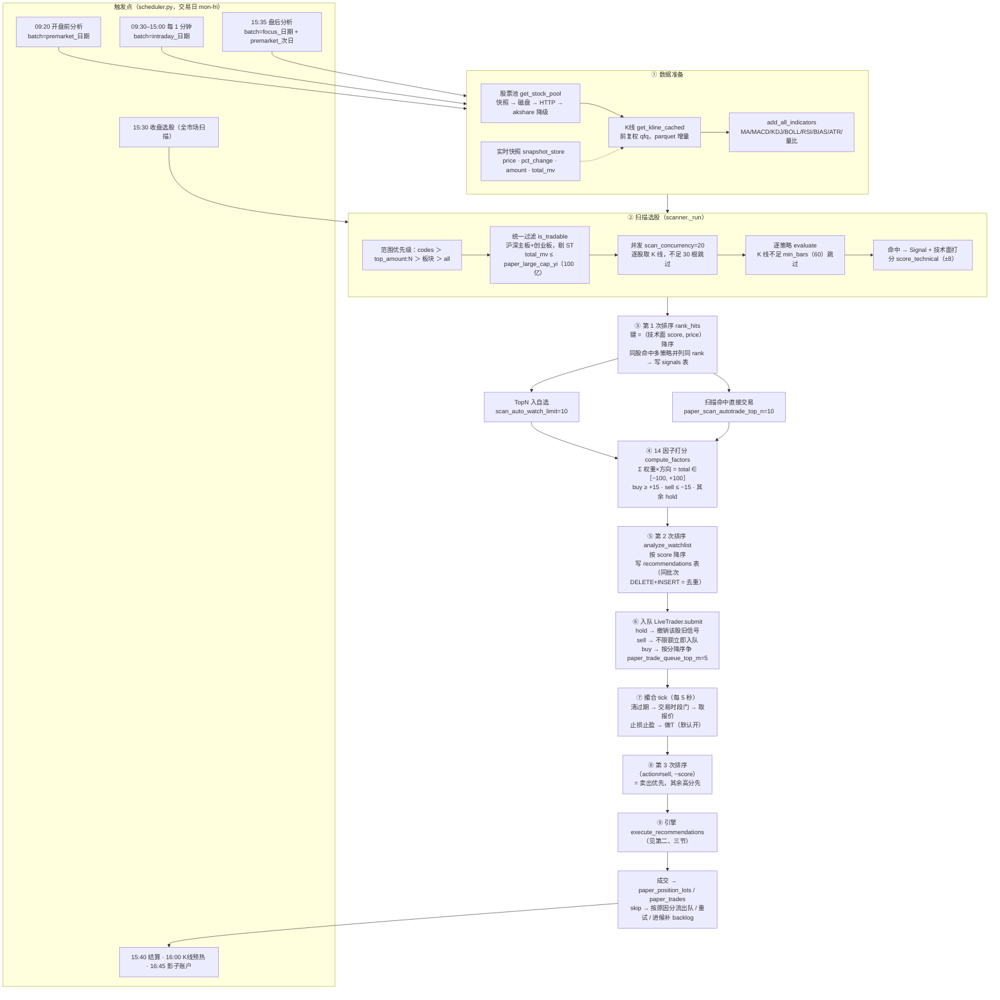
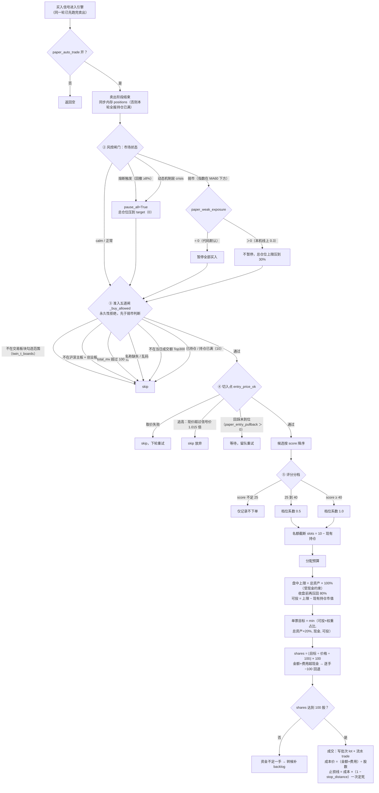
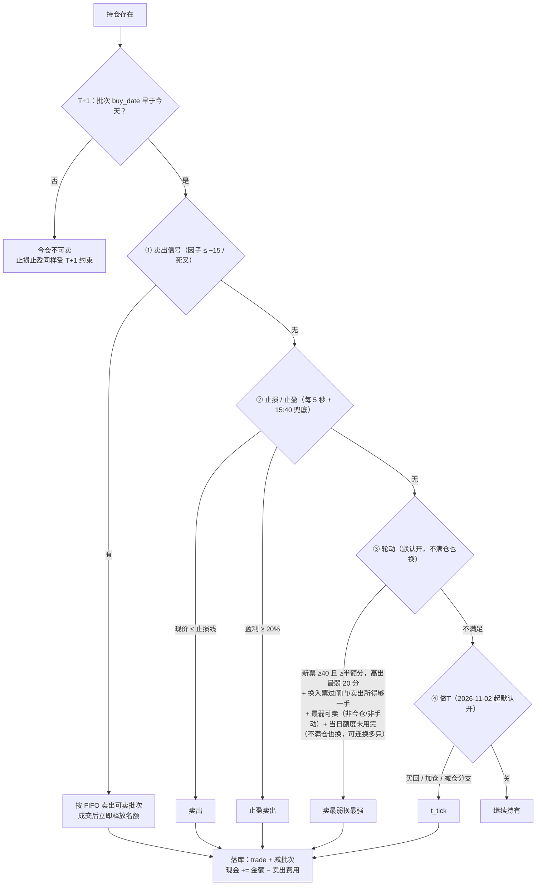

# SAS 全链路流程图 · 选股到交易

> 生成日期：2026-10-31；对应当前 `main`（`2ca4a1e` 之后）。
> 代码出处：`screener/scanner.py`、`analysis/factors.py`、`analysis/scoring.py`、`analysis/recommender.py`、
> `paper/live.py`、`paper/engine.py`、`monitor/scheduler.py`、`data/scope.py`、`config.py`。
>
> **本文件的定位**：`README.md` 讲「能做什么」，`docs/sas_formulas.md` 讲「公式是什么」，本文件讲
> **「一次买卖从哪来、经过哪些判定、被哪些参数挡住」**。参数默认值以 `config.py` 为准，本文件只做索引；
> 两者不一致时以代码为准，并请顺手修这里。

**目录**：[零、六阶段生命周期](#零六阶段生命周期唯一口径) · [一、端到端](#一端到端主流程) ·
[二、买入判定](#二单笔买入判定五段式--分档--预算) ·
[三、卖出与风控](#三持仓与卖出风控) · [四、参数总表](#四全参数总表按阶段) ·
[五、为什么没成交](#五为什么没买没卖skip-原因速查) · [六、三个排序](#六三个排序对照) ·
[七、举例](#七一次完整旅程举例) · [八、维护约定](#八维护约定)

> **读法**：每节先给**文字叙述**（按顺序编号，可直接当检查清单），后面才是对应的 Mermaid 图（同一个
> 流程的可视化汇总）。文字与图不一致时以文字为准，并请修图。

> **前提（贯穿全文）：只能做多，不做空。** 本系统面向散户，没有融券/卖空能力。本文件与代码里所有
> 「卖出 / sell」都是**平掉已有多头批次**，不是开空仓：
> ① 无持仓时卖出信号直接跳过（结果里写 `无持仓可卖`），不会生成空头仓位；
> ② 持仓股数由批次表 `paper_position_lots` 汇总，卖出按 FIFO 扣减 `reduce_paper_sellable()`，
> **上限就是可卖股数，不会减成负数**；
> ③ 回测同口径（无空头持仓、无融券成本、无做空收益），所以「空仓」只可能是现金等待，
> 不是反向持仓——下跌市里 0 仓位本身就是最优解（`BACKTEST_LOG` 关于「不做空 + 最高 80% 仓位」的归因）。

---

## 零、六阶段生命周期（唯一口径）

> 用户口径（2026-11-11）：「系统明确要有 **初选 → 入自选股 → 进交易队列 → 入场 → 持有 → 离场** 一整套策略」。
> 本节是这六个阶段的**唯一定义**：准入、准出、核心规则、数据落点、负责模块、当前实现状态。
> 下文一~八节是这六阶段的展开（第 9~14 步即「进交易队列 → 入场」）。口径不一致时以本节为准，并顺手修下文。
> **#190 只做口径明确化**（`app/`、设置项、`app_state`、`.env`、表结构零改动）。随后 **#191 按本节 0.5 清单补齐 P0/P1/P2 全部缺口**：默认零风险、不改既有交易行为（新开关默认关、新参数默认 0、底反默认不送队列），并新增只读的「生命周期」页把六阶段可视化（详见 `WORKLOG.md` #191）。

### 0.1 六阶段定义

| # | 阶段 | 定义 | 准入 | 准出（进入下一阶段的硬条件） | 核心规则 / 参数 | 数据落点 | 负责模块 |
|---|---|---|---|---|---|---|---|
| 1 | **初选** `SCREEN` | 全市场 → 候选集合 | 交易日；范围过滤（板块 / `top_amount:N` / 指定代码）；`is_tradable` 剔 ST、非白名单 | 命中策略 `Signal` 并完成第 1 次排序 | `scan_concurrency=20`、`min_bars=60`、`bottom_start_pos_max / dd20_min / turnover_min / min_avg_amount / min_factor_score`、`bottom_trend_filter` | `signals` 表、`data/last_scan.json`、`data/bottom_reversal_cache.json` | `screener/scanner.py`（主链路）、`screener/bottom_reversal.py`（底反面板） |
| 2 | **入自选股** `WATCH` | 候选 → 关注池 | 初选 TopN，或手动加入 / 持仓同步加入 | 出现在 `watchlist` 且通过范围过滤，可被 `analyze_watchlist()` 读到 | `scan_auto_watch_limit=10`、`watch_auto_max=30`、`auto_watch_enabled / auto_watch_top_n=10`、`prune_watch_auto` | `watchlist` 表（`code/name/note/source/score/created_at`） | `scanner._auto_watch_hits()`、`scheduler.auto_watch_top_hits()`、`api/watchlist.py` |
| 3 | **进交易队列** `QUEUE` | 关注 → **带时限的待执行指令** | `recommender` 产出 `action=buy/sell`（`hold` 撤旧信号、`focus` 不入队） | `submit()` 写入 `_pending`（满额转 `_backlog`），带 `expire_at / score / scan` | `paper_trade_queue_top_m=5`（卖单不受限）、`paper_signal_ttl_minutes=30`、`paper_backlog_max=30`、`paper_scan_autotrade_top_n=10` | 内存 `_pending/_backlog` + 镜像表 `paper_pending`（`kind=pending/backlog`） | `paper/live.py::submit()`、`analysis/recommender.py`、`api/advisory.py`（只读） |
| 4 | **入场** `ENTRY` | 指令 → 成交建仓 | 交易时段、队列未过期、`entry_gate()` + `entry_price_ok()` 全过 | 成交写批次 / 流水 / 持仓 / 现金 | 板块白名单 `twin_t_boards=创业板`、大盘四档（仅 `crisis` 硬拦）、涨停禁买、开盘冷却 5min、`paper_max_positions=10`、`paper_single_position_max=0.20`、`paper_full/half_score=40/25`、`paper_buys_per_tick=2`、`round_buy_qty()` | `paper_position_lots`（含 `provenance`）、`paper_trades`、`paper_positions`、`paper_pending` 出队 | `paper/live.py::tick()`、`paper/engine.py::execute_recommendations()` / `place_order()` |
| 5 | **持有** `HOLD` | 持仓期管理 | 有未平仓 lot | 触发任一离场条件 | 止损 `paper_stop_loss=0.08`（ATR 放宽）、止盈 `0.20`、保本 `0.10`、移动止损 `0.10`、做T `paper_t_active`、轮动、收盘减仓至 `paper_max_total_exposure=0.80`、T+1 `sellable_shares` | `paper_positions`（`stop_price/peak_price/t_t_sold/t_down_armed/...`）、`paper_equity`、`app_state` 择时快照 | `engine.check_stop_loss_target()` / `t_tick()` / `eod_trim()` / `settle()` |
| 6 | **离场** `EXIT` | 平掉多头批次并回写状态 | 止损 / 止盈 / 移动止损 / 保本 / 信号卖出（`factor_sell_threshold=-15`）/ 轮动换出 / 收盘减仓 / 清非交易板块 / 手动卖出 | lot 按 FIFO 扣减至 0，汇总行删除，现金与净值更新 | 卖出优先于买入（第 3 次排序）、`reduce_paper_sellable()` 只扣 `buy_date < today` 的批次、轮动买回评分门槛 | `paper_trades.reason`（自由文本）、`paper_position_lots`、`paper_positions`、`paper_equity` | `engine.check_stop_loss_target()` / `execute_recommendations()` / `t_tick()` / `eod_trim()` / `place_order()` |

> 执行顺序（每 5s tick）：`check_stop_loss_target` → `t_tick` → `execute_recommendations`（卖单优先）→ `eod_trim`；
> 15:40 `settle()` 再兜底一次止损止盈 + 净值定稿。**卖出永远排在买入前面**，且只能平多、不做空（见前文「前提」）。

### 0.2 状态机与当前存在的越级旁路

**唯一正常链路**：`SCREEN → WATCH → QUEUE → ENTRY → HOLD → EXIT →（可选）回 WATCH 观察`

允许的回路：`QUEUE` 过期 / 被拒 → 出队丢弃或转 `backlog`；`HOLD` 内做T、加仓只新增 lot，不新开阶段；
`EXIT` 后要重新入场必须重新走 `QUEUE`，且当日被轮动卖出的票受「买回所需最低评分」门槛约束。

**四条越级旁路**（#190 登记；#191 已修两条，另两条保留）：

| 旁路 | 路径 | 位置 | 影响 / 现状 |
|---|---|---|---|
| 扫描命中直连队列 | `SCREEN → QUEUE`，跳过 `WATCH` | `scanner.py::_trade_top_hits()`（开关 `paper_scan_autotrade`） | 队列里有不在自选股里的票；两套入队口径（保留，属有意的速通路径） |
| 底部反转面板孤立 | `SCREEN` 候选只写 JSON 缓存，**不进** `signals` / `watchlist` / `queue` | `screener/bottom_reversal.py::write_cache()`、`api/bottom_reversal.py` | **#191 已打通**：新增 `bridge_to_trade()` + 开关 `bottom_reversal_autobridge`（默认关），开启后候选写入 `signals` + `watchlist`（并可送队列），与 scanner 命中同一条下游；默认仍只是观察面板，不主动交易 |
| 手动下单越权 | 直接 `ENTRY`，跳过 `QUEUE` 与全部自动护栏 | `engine.py::place_order()` | **#191 已收窄**：手动买入现在仍跳过 `QUEUE`（属预期的人工越权路径），但会经统一宏观风险 `crisis` 硬拦 → `_buy_allowed`（板块范围 / 大市值 / 名称 / 成交额池 / 板块趋势闸门）→ 持仓名额 → `entry_price_ok` 四道护栏，不再直落库越权；手动单仓位上限同样纳入 Layer2 四档 cap |
| 明日关注不入队 | `focus` 只落 `recommendations` | `scheduler.py::post_market()` | 「明日关注」不会自动变成待执行指令（保留） |

### 0.3 与短线（≤5 日）口径的冲突 —— 最大缺口

- 回测侧有 `max_hold_days` / `time_stop_days` / `partial_tp_at` / `stop_confirm_close` / `trail_pct`；**线上 `PaperEngine` 一条都没有**。
  事实依据：`paper/ledger.py::UNSUPPORTED_REASONS` 逐项列明「时间止损需逐日盯持仓天数，引擎未实现」「分批止盈 / 收盘确认止损未实现」，`backtest/apply.py` 明确「实盘没有时间止损」。
- 即 `HOLD` 阶段目前是**无限期**：只有价格触发（止损 / 止盈 / 移动止损 / 做T）或收盘减仓才卖，没有「持有满 N 日强制离场」。
  且 `paper_positions.buy_date` 是 lots 的 `MAX(buy_date)`（最近一次买入，非首次建仓），做T后会后移，不能直接当持有天数用。
- 按 ≤5 日短线解读，六阶段中 **`HOLD → EXIT` 缺一条时间轴出口**；这是定义与实现之间最实质的差距。

- **#191 已补上时间轴出口**：新增设置 `paper_max_hold_days`（默认 **0** = 保持原「无限期」、不改现有交易行为），>0 时持仓满 N 个自然日即触发「时间止损」离场。`check_stop_loss_target()` 在止损 / 止盈之后新增该分支；计时从首个建仓批次 `lots.MIN(buy_date)` 起算（非 `paper_positions.buy_date` 的 `MAX`，避免加仓 / 做T 把计时后移重置），由既有的 T+1 闸门保证今仓次日才真正可卖。

### 0.4 其余已确认断裂（按影响排序）

1. **Layer2 统一风险四档 cap 未接入交易**：`unified_risk_cap_weak/shock/crisis = 0.30/0.20/0.10` 只出现在 `market_risk.py` 返回值、设置页与底反面板；`engine.py::effective_exposure` 不读它，实际只有 `crisis` 二值硬拦新开仓。 → **#191 已接入（P1-1）**：`engine.execute_recommendations` 与 `place_order` 在 `weak/shock/crisis` 档把 `effective_exposure` / `manual_exposure` 压到对应 cap（只降不升，零新增风险）；`crisis` 仍由 `should_block_buy` 全停新开仓。
2. **板块趋势过滤与入场闸门脱节**：`board_regime_for_code()` 全项目无调用点；`bottom_trend_filter` 只用于底反选股，`_buy_allowed()` 不查板块趋势。 → **#191 已接入（P0-3）**：新增开关 `paper_board_trend_gate`（默认关 = 零风险），开启后 `_buy_allowed()` 在候选所属板块指数处于 `downtrend` 时拒绝买入。
3. **两套自动加自选口径并存**：`scanner._auto_watch_hits`（`scan_auto_watch_limit` + `watch_auto_max` + `prune_watch_auto` 淘汰）与 `scheduler.auto_watch_top_hits`（`auto_watch_enabled` + `auto_watch_top_n`、无淘汰）写同一张表但互不知晓。 → **#191 已合并（P0 统一口径）**：`scheduler.auto_watch_top_hits` 现委托 `scanner._auto_watch_hits` 执行，15:30 `auto_scan` 与盘中扫描命中共用同一套「容量 + 淘汰」口径，消除「双容量 / 不淘汰」冲突。
4. **无统一生命周期主键**：`signals → recommendations → paper_pending → paper_trades → lots` 只靠 `code` + 日期关联；无 `signal_id` / `order_id` / `lot_id`，无法由 SQL 直接复盘「哪个信号导致哪笔成交」。 → **#191 部分缓解（P2-1）**：新增贯穿六阶段的 `lifecycle_events` 全局事件表 + `paper_trades.exit_reason` 结构化编码，可按 `code` 串起「初选→入自选→进队列→入场→离场」旅程；但 `signal_id/lot_id/order_id` 全链路主键仍未建，SQL 仍主要靠 `code` 关联。
5. **`watchlist` 无状态列**（只有 `source/note/created_at/score`）、无 TTL，`score` 只写不读；「是否已入队 / 已持仓」靠运行时现查。（#191：保留未改）
6. **`paper_pending` 是覆盖式内存镜像**（每次 `submit` 全表 DELETE 再 INSERT），无 `status` 列、无逐条状态机、无历史。（#191：保留未改）
7. **卖出侧无结构化溯源**：买入有 `provenance` JSON，卖出只有 `paper_trades.reason` 文本（轮动买回门槛靠正则反解析），无 `exit_reason_code`。 → **#191 已补（P1-3）**：`paper_trades` 新增 `exit_reason` 列（`TIME_STOP` / `STOP_LOSS` / `TAKE_PROFIT` / `ROTATION` / `OFFBOARD` / `EOD_TRIM` / `T_SELL` / `MANUAL` / `SIGNAL` / `OTHER`），由卖出写入点统一从 `reason` 兜底推断，覆盖所有卖出路径（买入侧保持 NULL）。
8. **展示层口径残留**：前端 `router.meta.stage` 只有 1~4 且未消费；`param_specs.py` 仍留「③ 三选 · 交易队列」旧文案；`README` / `flow.md` 二节仍称「五段式」。 → **#191 部分缓解（P2-2）**：新增「生命周期」页（`/lifecycle`，消费六阶段）把整条链路可视化，六阶段卡 + 时间线 + 代码/阶段筛选；但 `router.meta.stage` 仍为 1~4（入场页=4，未扩到 6），旧「三选 / 五段式」文案与 `README` 尚未清理（遗留）。

> **回测↔实盘一致性（#191 续，2026-11-12）**：上文 #1/#2/#7 的入场护栏（统一四档 cap、板块趋势闸门、危机硬拦）最初只落在 `paper/engine.py`，回测 `backtest/pipeline.py` 是另一套执行引擎、不会自动继承，导致「开启开关后回测≠实盘」。
> 本轮已把这三条规则**镜像进回测**，同样保持**默认关 / 默认 0、不改既有回测行为**：
> - 板块趋势闸门：`PipelineParams.board_trend_gate`（默认 None=沿用 `settings.paper_board_trend_gate`），新开仓前 `board_regime_for_code(code)` 为 `downtrend` 则拒买（主再平衡 + 日内买入两处）。
> - 危机硬拦：复刻 `should_block_buy()`（内部跟随 `entry_guard_block_declining_market`，关则零行为变更），仅拦新开仓。
> - 统一四档 cap：开关 `unified_risk_cap_enabled`（默认 None=沿用 `settings.paper_unified_risk_cap_enabled`），开启时把 `day_exposure` 与 `get_unified_market_risk()` 的 cap 取 min（只降不升），自动覆盖所有买入预算与做T加仓空间。
> 抽离模块级 `_buy_blocked(code, board_trend_gate)` 供单测；`should_block_buy`/`board_regime_for_code`/`get_unified_market_risk` 接入回测命名空间；结果 `params` 回显两开关实际取值（详见 `WORKLOG.md` #191）。**仍分叉项**：时间止损回测有独立 `max_hold_days`（与实盘 `_time_stop_hit` 概念一致、代码两份）；做T买回/网格加仓不拦（与实盘「只拦新开仓、做T买回不受影响」同口径）。完整回测对齐需在正常环境用真实行情数据复核。

### 0.5 落地清单（#191 已全部补齐，默认零风险）

> 用户 2026-11-11 确认「要，同时把缺口补上」后，**#191** 按下列清单落地。所有新增能力默认关闭 / 默认 0，**不改既有交易行为**：新开关默认关、新参数默认 0、底反默认不送队列。

- **P0 · 改变交易行为（已落地）**
  - 底反接交易链：`bottom_reversal.bridge_to_trade()` + 开关 `bottom_reversal_autobridge`（默认关），开启后候选写入 `signals` + `watchlist`（并可送队列），与 scanner 命中同下游；
  - 短线时间止损：新增 `paper_max_hold_days`（默认 0），>0 时按首个建仓批次天数触发「时间止损」离场；
  - 统一入自选口径：`scheduler.auto_watch_top_hits` 委托 `scanner._auto_watch_hits`，消除双容量 / 不淘汰冲突；
  - 手动买入护栏：`place_order` 经 `crisis` 硬拦 → `_buy_allowed` → 持仓名额 → `entry_price_ok` 四道护栏（仍需跳过 `QUEUE`，属预期人工越权）。
- **P1 · 口径统一（已落地）**
  - Layer2 四档 cap 进 `effective_exposure` / `manual_exposure`（只降不升）；
  - 板块趋势进 `_buy_allowed()` 闸门（开关 `paper_board_trend_gate`，默认关）；
  - 退出 `exit_reason` 结构化编码进 `paper_trades`（低侵入，从 `reason` 兜底推断；`signal_id/lot_id` 全链路串联**未做**，遗留）。
- **P2 · 可观测（已落地，部分）**
  - 生命周期事件表 `lifecycle_events` + 只读 API `/api/lifecycle/*` + 前端「生命周期」页（六阶段卡 + 时间线 + 筛选）；
  - 「清理五段式 / 三选旧文案」**未做**（遗留，见 0.4 #8）。

### 0.6 维护约定

新增或改动任一阶段，必须同步本节 + 一~四节 + `WORKLOG.md`；参数默认值以 `config.py` 为准（`.env` / `app_state` 覆盖层另计）。
改动交易规则时按 `AGENTS.md` 第 3 节同步 `README.md`、`docs/sas_formulas.md`、`WORKLOG.md`，并跑全量 `pytest`。

---

## 一、端到端主流程

### 文字版

**第 1 步 · 触发。** 三个入口，都在交易日：9:20 开盘前分析（`premarket_日期` 批次）；9:30–15:00 每 1 分钟（`intraday_日期`）；15:30 收盘选股（全市场扫描）与 15:35 盘后分析（`focus_日期` + 次日 `premarket_`）。
15:30 这一路走「扫描」，其余三路走「分析」（只分析自选股，不扫描）。两条路在第 4 步汇合。

**第 2 步 · 数据准备（每次执行重走一遍）。** 取股票池：内存实时快照优先，失败依次降级磁盘缓存 → HTTP → akshare；代码补零 6 位并清洗名称。
取 K 线：`get_kline_cached` 读本地 parquet，只补最后日期之后的增量，前复权。
加指标：MA5/10/20/60 → MACD → KDJ → BOLL → RSI → BIAS → ATR → 量比。**这一步不能省**——14 因子依赖这些列，缺了会让总分被压进 ±20。
同时备好实时快照（价格、涨跌幅、成交额、总市值），但只用于展示口径修正，不参与选股判定。
**注意分时图是另一条数据源**：它读本地分钟库（`D:\Backup\SAS\data\minute1_fsdb`，由 fsdb 导出、
计划任务 `SASMinutesFsdb` 每交易日 17:30 更新），与日 K **不同源**。两者日期不一致时，同一页面上
「报价/今开/最高」来自日 K 那一天的收盘，而「分时图」停在分钟库的最后一天（图内会标
「本地历史 · 某日」）——这不是缓存 bug，是分钟库没导出。

**第 3 步 · 定扫描范围（仅 15:30 那一路）。** 优先级从高到低：指定代码列表 > 成交额前 N（`top_amount:N`，解析失败默认 500）> 板块（沪/深/创业板/科创/北交）> 全市场。
定完范围后**所有分支统一再过一道** `is_tradable`：只留沪深主板 + 创业板（600/601/603/605/000/001/002/003/300/301），剔除 ST、退市；再按总市值不超过 100 亿过滤（受设置页开关控制）。

**第 4 步 · 并发单元。** 并发闸 `scan_concurrency=20`。扫描路每只票：取 K 线（不足 30 根跳过）→ 加指标 → 逐个策略 `evaluate`（K 线不足该策略 `min_bars`，默认 60，也跳过）→ 命中产出 Signal，并立刻算**技术面分**（均线 ±2、MACD ±1.5、KDJ ±1.5、量比 ±1、乖离 ±1，合计 ±8）。分析路每只自选股：取 K 线 → 加指标 → 算 14 因子。

**第 5 步 · 第 1 次排序。** 命中信号按「技术面分，同分看价格」降序；名次按**股票**编，同股命中多策略并列同名次。结果写 `signals` 表（`score` 是技术面分，`rank` 是名次）。
这一步的分数只用于**排序**，不决定买卖——与后面 ±100 的因子分是两套东西。

**第 6 步 · 两个副产物。** 按技术面分取前 10 只自动加自选（`scan_auto_watch_limit`）；若开着「扫描命中直接交易」，同样按分取前 10（`paper_scan_autotrade_top_n`）送去生成建议。

**第 7 步 · 14 因子打分。** 每个因子先给 −1 到 +1 的方向分，乘权重（合计 100）后求和得 `total`，落在 ±100。判级：`≥ +15` 判 buy，`≤ −15` 判 sell，其余 hold。
开了 ML 打分（默认关）时此处被 ML 分位覆盖；线上 ML 以成交额 TopN 为截面、`live_ml_industry_neutral` 控制行业中性，训练按 `as_of` 显式截断（标签 embargo + CV purge），与回测共用 seed 与严格零前视。但 `effective=false` 表示整段回退，结果与不开一模一样。

**第 8 步 · 第 2 次排序。** 一轮只取一次价格与情绪，并发分析后按 `score` 降序排名，写 `recommendations` 表。同批次「先删后插」，所以不会重复堆积——这就是去重的实现，没有额外冷却窗口。

**第 9 步 · 入队。** 先过两道门：队列总开关、交易模式。逐条处理：hold → **撤销**该股旧信号（以最新结论为准），不入队；sell → 立即入队且**不受容量限制**；buy → 按分降序，队列里同股视为更新不占新名额，队列买单数已达上限（默认 5）且该股不在队列 → 拒绝并计数。
每条信号带寿命（默认 30 分钟）；买单若当前不在开盘窗口，寿命延到下个窗口结束——**不是丢弃**。

**第 10 步 · 撮合（每 5 秒）。** 清过期 → 判交易时段（9:30–11:30 / 13:00–15:00，仅工作日）→ 把「持仓 + 队列 + 候补」合成观察集 → 逐只取实时报价（单只行情源优先，缺失用快照兜底，全失败本轮跳过）→ 跑止损止盈检查 → 跑做T（默认关）。

**第 11 步 · 第 3 次排序。** 排序键「是否卖单，再按分数降序」= **卖出永远排在买入前面**。若不在开盘窗口内（9:30 后 5 分钟内），所有买单被摘出来**留在队列**等下一个窗口，本轮只执行卖出。窗口内还会按分补一次候补队列。

**第 12 步 · 交给引擎。** 分工：**队列管「什么时候、哪些、什么顺序、能活多久」，引擎管「这一笔允不允许、买多少、多少钱、落哪张表」**；队列只调用一次引擎（详见第二、三节）。

**第 13 步 · 结果分流。** 成交写批次表与流水表。跳过按原因处理：取价失败 / 等待回踩 → 留队重试；持仓已满 / 总仓位已达上限 / 资金不足一手 → 转候补队列（上限 30，收盘前有效）；其余（追高、不在池子、名称不可信等）→ 直接出队并计入「切入点判定」面板。

**第 14 步 · 收尾。** 15:40 结算（净值快照 + 顺带写一条择时快照）；16:00 K 线预热后刷新广度；16:45 影子账户跑 `default` vs `default_ml`。注意**盘中净值并非等到 15:40 才写**：每个 tick 有成交立即 upsert 当日净值，无成交也每 30 秒按最新价重估一次（主账本与各并行账本同口径），15:40 用收盘价覆盖定稿。

### 流程图



**每一层「为什么这么设计」**

| 环节 | 理由 |
| --- | --- |
| 扫描范围默认 `all`，推荐 `top_amount:500` | 全市场 5000 只冷缓存下要实时拉 K 线；成交额 TopN 近似流动性，先剔掉没人交易的票 |
| 技术面 ±8 分只用于 `signals.rank` | 它是**排序**用的粗筛，不决定买卖；买卖判定在 14 因子（±100）。两套分数分层，不要混用 |
| 三处长度保护（30 根 / `min_bars` 60 / 因子 `len<6`） | MA60、BOLL20、ATR14 都要足够样本，不足宁可不给信号 |
| 建议里的 `stop_loss=10 日最低`、`target=×1.15` | **展示用参考位**，不是执行位；执行止损走引擎 `max(8%, 2×ATR)`。两套数字并存，界面/日志里要分清 |
| 卖出先于买入、且不受队列容量限制 | 卖是释放风险与名额，不该被「队列满了」挡住；买入才需要限额防止预算被摊薄 |
| 买单窗口外**留队**而不是丢弃 | 与回测「次日开盘价成交」同口径；窗口外丢弃等于把信号变成噪声 |

---

## 二、单笔买入判定（五段式 + 分档 + 预算）

### 文字版

**第 1 步 · 前置。** 自动交易开关关着 → 直接返回空。否则先跑完本轮所有卖出；**卖出成交后立刻同步内存持仓表**（清仓就删、部分卖就改股数）——不同步的话后面的名额判断还以为满仓，本轮所有买单都会报「持仓已满」。

**第 2 步 · 风控闸门（决定"总仓位能到多少"）。** 按优先级：组合回撤熔断触发（回撤 ≥ 8%）→ 全暂停，总仓位上限压到 0；否则动态机制层判 crisis → 同样全暂停；否则静态择时判弱市（指数前收盘在 MA60 下方）→ 看弱市保留比例，为 0 就**全暂停买入**，大于 0 则不暂停、只把总仓位上限压到该比例（本机线上 0.3）；其余按 80%。
这一层只压上限，不会抬高上限。

**第 3 步 · 准入五道闸（永久性拒绝，先于弱市判断）。** 依次检查，任一不过即跳过：① 北交所（按开关）；② 不在沪深主板 + 创业板范围；③ 总市值超过 100 亿（按开关）；④ 名称缺失 / 等于代码 / 含乱码（名称取不到往往说明股票池不完整）；⑤ 不在当日成交额前 300 池（快照拿不到时本轮不限制）。
这一层之后继续判：是否已持仓、持仓只数是否已满（默认 10）。
顺序关键：永久性原因必须排在「大盘弱势」之前，否则弱市期间面板一片「大盘弱势」，把「本来就不该买」伪装成临时拒绝。

**第 4 步 · 切入点。** 取实时价（取不到则跳过，下轮重试）。价格有效后判两件事：追高——现价高于信号价 1.5% 以上直接放弃；回踩（默认不启用）——要求现价曾跌到信号价下方一定比例，没到就返回「等待回踩」，**留队等**而不是放弃。

**第 5 步 · 候选排序与名额截断。** 通过的候选按分数降序。名额 = 10 − 现有持仓；候选多于名额时只让名额内的高分票参与分钱，否则预算会被「反正也买不到」的候选摊薄，结果只建两三成仓。

**第 6 步 · 评分分档。** 不足 25 分 → 只记录不下单；25 到 40 分 → 档位系数 0.5；40 分以上 → 系数 1.0。也就是说同一只票分到多少钱，除分数本身还乘了档位系数。

**第 7 步 · 分钱（三步）。** ① 盘中上限 = 总资产 × 有效仓位比例（盘中按 **100%（只受现金约束）**，风控闸门压得更低时按闸门值；80% 是**收盘目标**，由收盘减仓压回）；② 本轮可投 = 上限 − 现有持仓市值，不足取 0；③ 每只票目标金额 = 取四者最小值：本轮可投按权重分到的份额、总资产 × 20%（单票上限）、可用现金、本轮可投总额。

**第 8 步 · 整手与费用回退。** 股数 = 目标金额 ÷ 价格 ÷ 100，向下取整再乘 100；再检查「金额 + 买入费用」是否超现金，超了每次减 100 股重算，直到买得起。

**第 9 步 · 成交落库。** 写买入批次（含买入日期、成本价）与流水。成本价是**含费成本** =（金额 + 费用）÷ 股数。同时把止损线定死：固定止损 8% 与 2×ATR 取较大者、上限 20%，乘到成本价上写进批次——日后复盘能回答「当时定的止损是多少」。

**第 10 步 · 落不下来时。** 减到不足 100 股 → 放弃并转候补队列（说明是资金/仓位问题，不是这只票不行）。

### 流程图



### 参数选择与理由

| 参数 | 默认 | 为什么是这个值 |
| --- | --- | --- |
| `paper_half_score` / `paper_full_score` | 25 / 40 | 14 因子 `total` 天然落 ±100，但 ±15 就算 buy → 过线者可能几十只。25/40 把「勉强过线」与「强信号」分开：前者只记不发钱，后者拿全额权重 |
| `paper_max_positions` | 10 | **上限不是门槛**：可以少于 10 只，不能超过；10 只 × 单票 20% = 200% 远超资金上限 → 实际能持几只由现金决定 |
| `paper_max_total_exposure` | 0.80 | **收盘目标**：盘中允许满仓，收盘前 10 分钟压回 80%，留现金给次日做T（回测仍把它当买入上限，无收盘减仓，见 `#93`） |
| `paper_single_position_max` | 0.20 | 同上，多数时候不起作用；真正起作用在**候选少**时——2 只候选各买 20%，剩 40% 空着等更好的机会，而不是各买 40% |
| `paper_entry_max_chase` | **0（关闭）** | 2026-11-01 由 0.015 改为 0：6 段配对中位 **−4.54pp**、正占比 2/6、最差段 −22.46pp，且成交笔数没减少（是「买差」不是「少买」），**不采纳**（`BACKTEST_LOG` #89）。此前「放开到全时段买入」的 −1.18pp 结论见 #58 |
| `paper_buy_open_window_minutes` | 5（**本机线上 0 = 窗口关闭**） | 与回测「次日开盘价成交」同口径；盘中信号若在窗口外产生，买单顺延到下一个开盘。线上置 0 后交易时段全时段可买，**与回测口径不一致**（`WORKLOG` 2026-11-02） |
| `paper_pool_top_n` | 300 | 线上池子，`/api/backtest/defaults` 让 `universe_size` 跟随它；但 `BacktestParams` 数据类默认是 **500**，直接跑 `scripts\*.py` 要显式 `--universe 300`，否则写死 500 再和线上比 = 两个实验（`#70` 口径红线） |
| `paper_large_cap_yi` | 100 亿 | 排除银行/石油这类「买了也不动」的票；关掉开关时市值阈值过滤同时失效 |
| `paper_trade_queue_top_m` | 5 | 同一轮最多 5 只争钱，否则预算被 20 只平摊成「每只都不够一手」 |

---

## 三、持仓与卖出（风控）

> 本节所有「卖出」都是**平多（reduce）**，不是开空。没有持仓就没有卖出动作；持仓清零即回到空仓（现金）。

### 文字版

**第 1 步 · T+1 前置。** 卖出只动「买入日期早于今天」的批次，按最老先卖（FIFO）。当日买入的部分不可卖——止损止盈同样受这条约束。

**第 2 步 · 卖出信号（优先级最高的主动卖出）。** 因子总分 ≤ −15 判 sell，入队后立刻执行。部分卖出时只减可卖批次，剩余今仓仍占持仓名额。

**第 3 步 · 止损止盈（每 5 秒检查，收盘再兜底一次）。** 止损线建仓时已定死，盘中只抬高不降低：浮盈达 10% → 止损线上移到成本价（保本）；从持仓期最高价回撤 10% → 卖出（移动止损，默认建仓起就跟踪）。现价跌到止损线 → 卖；浮盈达 20% → 止盈卖。
实际常见路径是「涨到 +10% 后回撤 10% 离场」，很少走到 +20% 硬止盈。

**第 4 步 · 轮动替换（2026-11-02 起默认开，且不再要求满仓）。** `paper_max_positions(10)` 是上限不是门槛：持仓可以少于 10 只；只要有新候选分数 ≥ 40 **且 ≥ 半额分 25**、比「当前最弱可卖持仓」的建仓分高出 20 分、该持仓不是当日买入/不是手动建仓，就把它换掉。**一次可连换多只、可把持仓全换掉**，不必等止损止盈；总额度是每日轮动**只数** `paper_rotation_max_per_day`（默认 10 ≈ 不限）。
**换入票必须真能买进**：与买入同一套闸门（板块/北交所/大市值/名称/成交额池 + 不追高/回踩），且卖出所得够买一手；否则不卖——只卖不买等于凭空降仓。候选除本轮买入建议外，还包含**候补队列**里未持仓的买单。
打开的依据是「模拟盘先把规则跑全」（`#92`），不是 alpha 证据；机制修复见 `#91`，口径变更见 `#93`。

**第 5 步 · 做T（2026-11-02 起默认开）。** 每个 tick 对每只持仓判断一个动作（买回 / 加仓 / 减仓 / 不动），每只票每 tick 只做一个动作，且有大盘急跌护栏。摩擦成本依旧是主要风险：每 0.1% 滑点约等于 −0.93pp（`#66`）；默认开启是「模拟盘先跑机制」的取舍（`#92`），不是回测结论，归因时先看有没有做T成交。

**第 6 步 · 收盘减仓（默认开，只在收盘前 10 分钟）。** 80% 是**收盘目标**：盘中允许满仓，收盘前按「建仓分最低优先」把超出 80% 的部分卖掉，留现金给次日做T；今仓 T+1 卖不掉就跳过，不强求。

**第 7 步 · 都不触发。** 继续持有，等下一个 tick。

### 流程图



### 止损线怎么定

```
stop_distance = clamp( max(paper_stop_loss 8%, paper_atr_stop_mult 2.0 × ATR%), 上限 paper_atr_stop_max 20% )
stop_price    = 成本价 × (1 − stop_distance)          # 建仓时写死，便于复盘「当时定的止损是多少」

盘中只抬不降：
  浮盈 ≥ paper_breakeven_pct（10%）  → 止损抬到成本价（保本）
  浮盈 ≥ paper_trail_arm（0，建仓即跟踪）→ 止损抬到 peak × (1 − paper_trail_pct 10%)
  实际常见路径：涨到 +10% 后回撤 10% 离场，很少走到 +20% 硬止盈
```

| 风控参数 | 默认 | 说明 |
| --- | --- | --- |
| `paper_regime_ma` / `paper_regime_weak_pause` | 60 / True | 静态择时闸门：指数前收盘低于 MA60 → 弱市 |
| `paper_weak_exposure` | 0（**本机线上 0.3**） | 0 = 弱市全暂停（当天必然零成交，曾造成误判）；0.3 = 只降仓不全停（`#63`） |
| `paper_dynamic_exposure` | False | 四态（calm/weak/shock/crisis）统一降仓；落地但**未经配对回测**（`#84`） |
| `paper_policy_floor_enabled` | False | 政策托底分治，**必须与 `paper_dynamic_exposure` 同开**才生效（`#85`） |
| `paper_circuit_breaker_enabled` | False | 组合回撤 ≥8% 锁仓、≤4% 才解除；峰值与触发态落库跨重启保留 |
| `paper_rotation_*` | **True** / 40 / 20 / 1 | 模拟盘默认开（`#92`）；Top300 池下几乎不触发，却一旦触发就是换手主因（`#30`）。换入票须过交易池/切入点闸门且卖出所得够一手，候选含候补队列（`#91`） |
| `paper_t_active` | **True**（2026-11-02 起，config/`.env`/覆盖层一致） | 做T 开关：每 0.1% 滑点 ≈ −0.93pp（`#66`），默认开启属模拟盘取舍（`#92`），归因要与基础策略分开 |

---

## 四、全参数总表（按阶段）

| 阶段 | 参数 | 默认 | 作用 |
| --- | --- | --- | --- |
| 扫描 | `scan_concurrency` | 20 | 并发数（IO 密集，再高收益递减） |
| | `scan_auto_watch_limit` | 10 | 每次扫描自动加自选数量 |
| | `paper_scan_autotrade` / `_top_n` | True / 10 | 扫描命中直接进建议 + 交易 |
| | `paper_scan_autotrade_overnight` | True | 盘后允许顺延到次日开盘 |
| 打分 | `factor_buy_threshold` / `factor_sell_threshold` | +15 / −15 | 14 因子 total 判级线 |
| | `live_ml_scoring` | **False**（config 默认）/ **线上 True**（2026-11-01 起，`#88`） | ML 替换因子分；`effective=false` 时整段回退，结果与基线相同（`#79`） |
| | `live_ml_industry_neutral` | True | ML 行业中性；与回测 `industry_neutral` 双向绑定 |
| 建议 | `intraday_analysis_interval` | 1 分钟 | 盘中分析频率 |
| | `focus_top_n` | 10 | 明日关注数量 |
| 队列 | `paper_tick_interval` | 5 秒 | 撮合频率 |
| | `paper_signal_ttl_minutes` | 30 | 信号寿命 |
| | `paper_trade_queue_top_m` | 5 | 买单队列容量（卖不限额） |
| | `paper_backlog_enabled` / `_max` | True / 30 | 满仓或没钱时转候补，收盘前有效 |
| | `paper_entry_timeout_minutes` | 0 | >0 时收紧买单寿命（默认不覆盖 TTL） |
| | `paper_entry_pullback` | 0.0 | >0 要求先回踩信号价以下才买（留队等待） |
| 仓位 | `paper_initial_capital` | 100,000 | 初始资金 |
| | `paper_max_positions` | 10 | 同时持仓**上限**（不是门槛，可以少于 10 只） |
| | `paper_max_total_exposure` | 0.80 | **收盘目标**仓位（盘中允许满仓，收盘前由 `eod_trim` 压回） |
| | `paper_eod_trim_enabled / _minutes` | True / 10 | 收盘减仓开关与窗口（14:50 起，今仓卖不掉就跳过） |
| | `paper_single_position_max` | 0.20 | 单票上限 |
| 风控 | `paper_stop_loss` / `paper_take_profit` | 8% / 20% | 固定止损止盈 |
| | `paper_atr_stop_mult` / `paper_atr_stop_max` | 2.0 / 20% | ATR 放宽止损及其上限 |
| | `paper_breakeven_pct` / `paper_trail_pct` / `paper_trail_arm` | 10% / 10% / 0 | 保本、移动止损、启用门槛 |
| | `paper_regime_ma` / `paper_regime_weak_pause` | 60 / True | 大盘择时闸门 |
| | `paper_weak_exposure` | 0（线上 0.3） | 弱市保留仓位比例 |
| | `paper_dynamic_exposure` / `paper_policy_floor_enabled` / `paper_circuit_breaker_enabled` | 全 False | 机制层三件套，均未经配对回测 |
| | `paper_rotation_enabled` 等 4 项 | **True** / 40 / 20 / **10**（`max_per_day` = 每日轮动只数，0 = 当日不轮动） | 轮动替换：**不满仓也能换、一次可换多只**；换入票须过闸门且卖出所得够一手，候选含候补队列（`#91`/`#93`）；默认开见 `#92` |
| | `paper_t_active` 等 8 项 | **True**（2026-11-02 起） | 做T 引擎；数值参数默认保守（下跌加仓 0.2 ≈ 关闭） |
| 费用 | `trade_fee_commission_rate` / `_min` | 0.00025 / 5 元 | 佣金万 2.5、最低 5 元，双边 |
| | `trade_fee_stamp_rate` / `_transfer_rate` | 0.001 / 0.00001 | 印花税（仅卖）、过户费（双边） |
| 池子 | `paper_pool_top_n` / `paper_exclude_large_cap` | 300 / True | 成交额池、大市值 |

> 以上全部可在「系统设置」页调，改完下一个 tick / 下一轮扫描即生效。
> **判断是否真的生效要看 `GET /api/settings` 的 `source` 字段**——`app_state` 的 `cfg:` 覆盖层
> 优先级高于 `.env` 与 `config.py` 默认值。

---

## 五、「为什么没买/没卖」skip 原因速查

出问题先对号，别急着调参数：

| skip 原因 | 归属 | 常见误判 |
| --- | --- | --- |
| `持仓已满(N只)` | 引擎名额 | 同批卖出后仍报 → 检查内存 `positions` 是否同步 |
| `可用资金不足一手(N元)` | 预算 | 现金压在持仓里（盘中上限=现金）；不是「没名额」，也不是被 80% 拦的 |
| `大盘弱势，暂停买入` | 择时闸门 | 弱市 + `weak_exposure=0` 时**全天零成交是设计行为**（`#63`） |
| `不在当日成交额Top300池` | 准入 | 池子用**当天**成交额算，早盘与收盘结果不同 |
| `仅记录不下单`（评分不足 25） | 分档 | 多半是 **14 因子喂了没有指标的 frame**，`total` 被压进 ±20 的假象 |
| `等待回踩` / `追高（高于信号价 1.5%）` | 切入点 | 前者留队重试，后者直接放弃，语义不同 |
| `T+1 当日买入不可卖` | 批次模型 | 当日加仓部分不可卖，老批次照卖 |
| `取价失败` | 数据源 | 快照与 K 线同时挂才算失败，会自动重试 |

---

## 六、三个排序对照

| # | 名称 | 函数 | 排序键 | 分数来源 / 区间 | 落库 |
| --- | --- | --- | --- | --- | --- |
| 1 | `signals.rank` | `rank_hits`（`screener/scanner.py`） | `(技术面 score, price)` 降序；名次按唯一 code 递增（同股多策略并列） | `score_technical`（`analysis/scoring.py`）**±8**：均线 ±2、MACD ±1.5、KDJ ±1.5、量比 ±1、乖离 ±1 | `signals.score / rank` |
| 2 | 建议 `score` / `rank` | `compute_factors` 算 total；`analyze_watchlist` 排序 | `Recommendation.score` 降序，`rank` 从 1 起 | 14 因子加权 Σ（权重合计 100）→ **±100**；`live_ml_scoring=True` 时换成成交额 TopN 截面的 ML 分位 0–100 | `recommendations.score / rank / detail` |
| 3 | 交易队列顺序 + 仓位权重 | `LiveTrader.tick` + `PaperEngine.execute_recommendations` | 队列 `(action≠sell, −score)`；引擎内 `score` 降序，再按 `score × 档位系数(1.0/0.5)` 分钱 | 沿用第 2 次的 `score` | `paper_positions.score`、`paper_trades.reason` |

辅助排序（不是「三排序」，但会出现在日志/界面里）：
`post_market_focus` 按技术面分取 `focus_top_n=10`；`submit` 内买单按分争 `top_m=5`；
`_auto_watch_hits` 按技术面分取 `scan_auto_watch_limit=10`；
`_trade_top_hits` 按技术面分取 `paper_scan_autotrade_top_n=10`。

---

## 七、一次完整旅程（举例）

把三张图串起来看一遍，用一只假设的票走完全程：

1. **15:30 收盘扫描**：命中「均线放量」，技术面 +5 分 → 进 `signals` 靠前位置 → 同时在「自动加自选」的 10 只里。
2. **立刻生成建议**：14 因子算出 +42 分 → 判 buy → 按分降序排到第 3 名 → 入队（队列此时还空，占一个名额）。
3. **不在开盘窗口**：信号寿命不按 30 分钟算，而是延到次日 9:30 + 5 分钟。
4. **次日 9:20 开盘前分析**：再次确认 buy。队列里同股被覆盖更新，**不占新名额**。
5. **9:30 窗口打开，tick 取价**：现价比信号价高 0.8%，未超 1.5% 追高线 → 过切入点。
6. **准入与名额**：五道闸全过，名额剩 7 个 → 42 分 ≥ 40，档位系数 1.0。
7. **分钱**：可投预算按权重分到约 2.1 万，但单票上限 2 万 → 取 2 万。
8. **整手**：2 万 ÷ 价格 ≈ 1900 股 → 向下取整 1900 股；含费总额仍在现金内 → 成交。
9. **落库**：成本价为含费成本，止损线 = 成本 ×（1 − max(8%, 2×ATR)）写进批次，等后续 tick 抬升或触发。

**若中途失败，结果长什么样：**

| 卡在哪 | 结果里的原因 | 该调什么 / 不该调什么 |
| --- | --- | --- |
| 第 2 步风控闸门 | `大盘弱势，暂停买入` | 调 `paper_weak_exposure`（0 → 0.3）；**不要**去调追高线，这单根本没走到那一步 |
| 第 3 步准入 | `不在当日成交额Top300池` | 池子按当天成交额算，早盘与收盘不同；确认不是股票池不全 |
| 第 3 步名额 | `持仓已满(10只)` | 若同批刚卖出还报这个 → 查内存 `positions` 是否同步 |
| 第 4 步切入点 | `追高（高于信号价 1.5%）` 或 `等待回踩` | 前者直接放弃，后者还在队里等——两者语义不同 |
| 第 6 步分档 | `仅记录不下单` | 先查是不是 14 因子喂了没有指标的 frame（`total` 被压进 ±20） |
| 第 8 步资金 | `资金不足一手` | 转候补队列，属资金/仓位问题，不是票的问题 |

---

## 八、维护约定

1. **代码改了要同步这里**：涉及新增强制闸门、新增参数、改变判定顺序时，改完代码立刻改本文件对应图/表。
2. **公式细节写 `docs/sas_formulas.md`**，本文件只画流程与索引参数；同一个公式不要在两处各写一遍。
3. **参数默认值以 `backend/app/config.py` 为准**，本文件不复制注释，只写「默认值 + 为什么」。
4. **改完在 `WORKLOG.md` 第十一节记一条**，写清「为什么」；若是一次回测实验的结论，另写 `BACKTEST_LOG.md`（编号唯一）。
